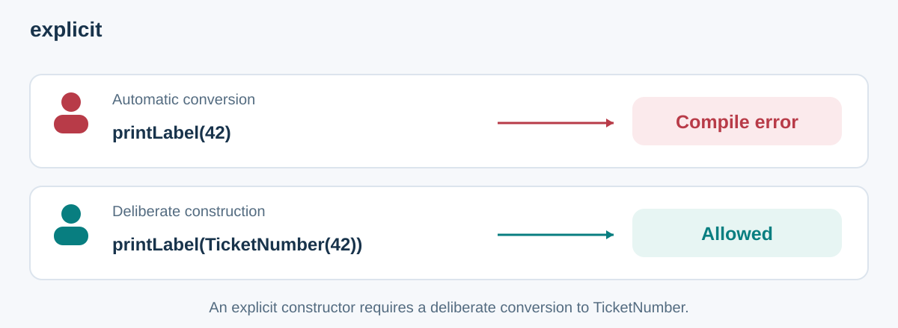
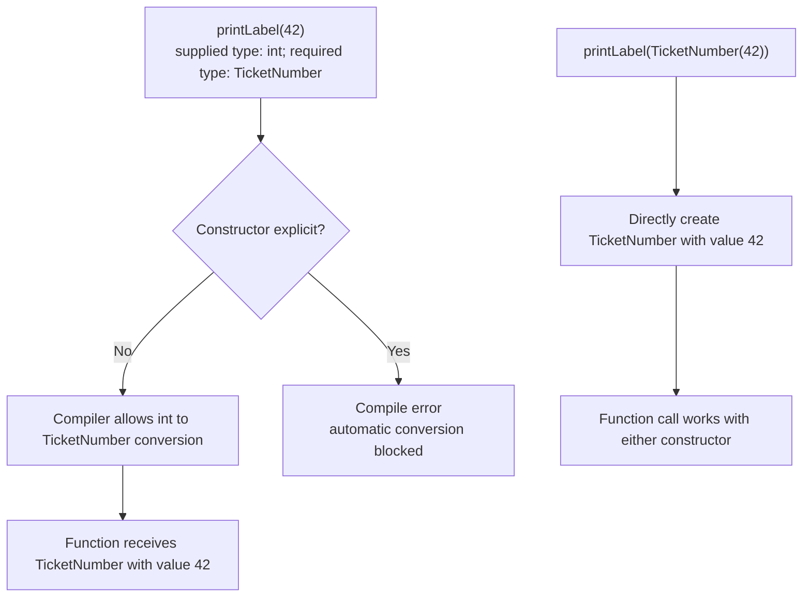
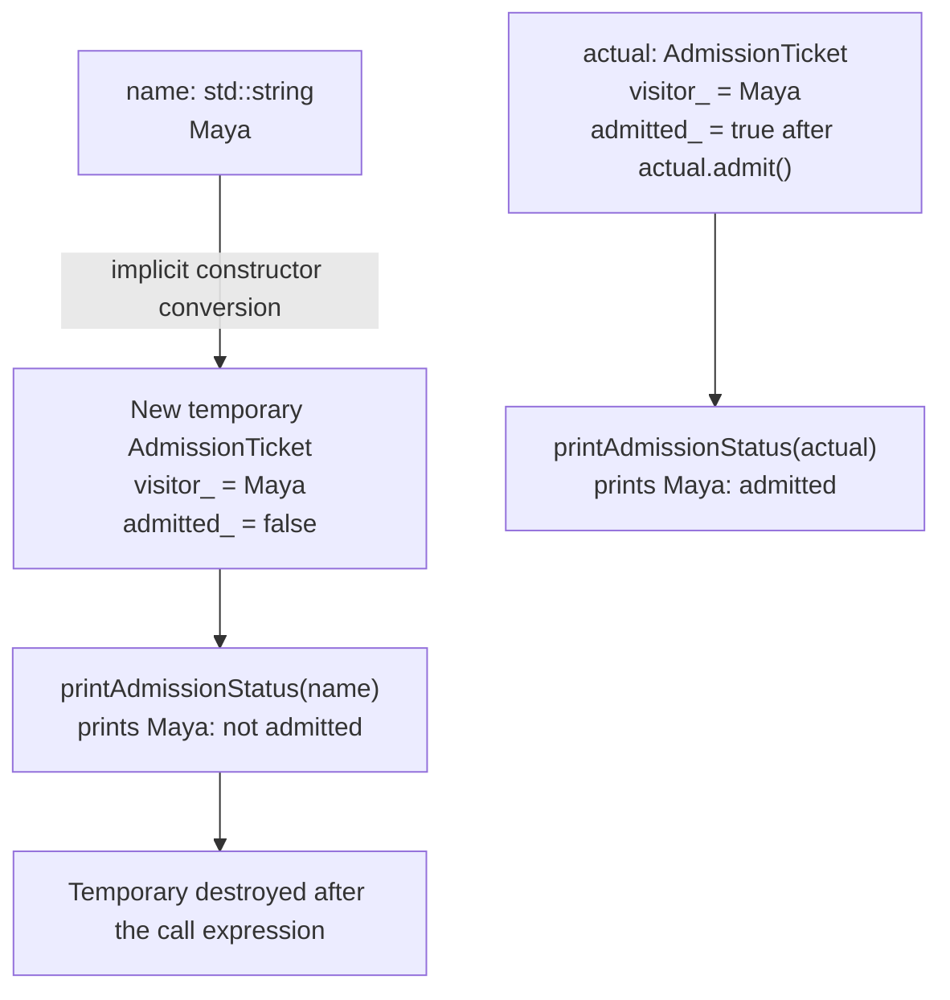

# `explicit`: Make Object Creation Visible

**`explicit` prevents C++ from using a constructor to automatically turn a supplied value into an object of your class** [1]. You can still create the object by writing its type and arguments directly.

For example, a `TicketNumber` gives meaning to the number 42. With an explicit constructor, `printLabel(42)` is rejected, while `printLabel(TicketNumber(42))` clearly asks to create a ticket number.

This note uses museum tickets, matching the examples in the [OOP notes](../OOPS/01_ClassesAndObjects.md). Each complete program is independent and requires C++11 or newer.

## Contents

1. [The problem: a value becomes an object automatically](#1-the-problem-a-value-becomes-an-object-automatically)
2. [Without explicit vs. with explicit](#2-without-explicit-vs-with-explicit)
3. [Which ways of creating an object still work?](#3-which-ways-of-creating-an-object-still-work)
4. [A temporary ticket can give the wrong answer](#4-a-temporary-ticket-can-give-the-wrong-answer)
5. [Other places explicit can be used](#5-other-places-explicit-can-be-used)
6. [Common mistakes](#6-common-mistakes)
7. [Checklist and self-test](#7-checklist-and-self-test)

For quick visual revision: [which conversions compile](#flowchart-automatic-conversion-versus-direct-creation) → [why a temporary ticket has different state](#object-diagram-a-name-creates-a-new-ticket).

## 1. The problem: a value becomes an object automatically

A converting constructor lets C++ create an object when a function expects that class but receives another type. `explicit` requires the caller to request that construction deliberately.



## 2. Without explicit vs. with explicit

### 2.1 Without explicit: the constructor allows automatic conversion

```cpp
#include <iostream>

class TicketNumber {
public:
    TicketNumber(int value) : value_(value) {}

    int value() const {
        return value_;
    }

private:
    int value_;
};

void printLabel(TicketNumber number) {
    std::cout << "Ticket number: " << number.value() << '\n';
}

int main() {
    printLabel(42);          // C++ creates TicketNumber(42) for this call.
    TicketNumber number = 7; // C++ converts 7 into a new TicketNumber.
    printLabel(number);
}
```

Output:

```text
Ticket number: 42
Ticket number: 7
```

`printLabel(42)` implicitly creates a `TicketNumber` from the integer. Decide whether this automatic conversion makes sense for the type.

### 2.2 With explicit: write the object creation yourself

The only class change is adding `explicit` before its constructor:

```cpp
#include <iostream>

class TicketNumber {
public:
    explicit TicketNumber(int value) : value_(value) {}

    int value() const {
        return value_;
    }

private:
    int value_;
};

void printLabel(TicketNumber number) {
    std::cout << "Ticket number: " << number.value() << '\n';
}

int main() {
    printLabel(TicketNumber(42)); // The type name makes object creation clear.
    TicketNumber number(7);      // Directly create the named object.
    printLabel(number);

    // printLabel(42);          // Error: this needs an automatic conversion.
    // TicketNumber other = 7; // Error: this form cannot use the explicit constructor.
}
```

Output:

```text
Ticket number: 42
Ticket number: 7
```

`explicit` changes which calls compile. It does not change the stored number or the printed labels.

### Flowchart: automatic conversion versus direct creation

This compares the two `TicketNumber` constructors above. The rejected branch is a compile error; it does not reach `printLabel()` at runtime.



**Recall question:** Does `explicit` stop construction from an integer? It stops this automatic conversion; writing `TicketNumber(42)` still works.

## 3. Which ways of creating an object still work?

### 3.1 Direct creation works with explicit

Using the explicit class above:

| Code | Compiles? | Why? |
|------|-----------|------|
| `TicketNumber number(42);` | Yes | The type and constructor argument are written directly |
| `TicketNumber number{42};` | Yes | Braces also directly supply the constructor argument |
| `printLabel(TicketNumber(42));` | Yes | The call explicitly creates a ticket-number object |
| `TicketNumber number = 42;` | No | This form asks C++ to convert the plain integer automatically |
| `printLabel(42);` | No | The argument needs an automatic integer-to-ticket conversion |
| `TicketNumber number = TicketNumber(42);` | Yes | The value on the right is already a deliberately created ticket number |

### 3.2 Initialization names describe these forms

- **Direct initialization:** `TicketNumber number(42)` or `TicketNumber number{42}` directly gives the constructor its argument. An explicit constructor is allowed.
- **Copy initialization:** `TicketNumber number = 42` asks C++ to initialize from the value on the right. An explicit constructor cannot perform that integer-to-ticket conversion [2].

The `=` symbol alone does not mean explicit constructors are always forbidden. `TicketNumber number = TicketNumber(42)` works because the right-hand expression already creates the correct type.

## 4. A temporary ticket can give the wrong answer

A **temporary object** is an unnamed object created for an expression. In the following program, an automatic conversion creates a new ticket just to satisfy a function call:

```cpp
#include <iostream>
#include <string>

class AdmissionTicket {
public:
    AdmissionTicket(const std::string& visitor) : visitor_(visitor) {}

    std::string visitor() const {
        return visitor_;
    }

    bool admit() {
        if (admitted_) return false;
        admitted_ = true;
        return true;
    }

    bool isAdmitted() const {
        return admitted_;
    }

private:
    std::string visitor_;
    bool admitted_ = false;
};

void printAdmissionStatus(const AdmissionTicket& ticket) {
    std::cout << ticket.visitor()
              << (ticket.isAdmitted() ? ": admitted\n" : ": not admitted\n");
}

int main() {
    AdmissionTicket actual("Maya");
    actual.admit(); // Record entry on the existing ticket.

    std::string name = "Maya";
    printAdmissionStatus(name);   // C++ creates a new ticket from the name.
    printAdmissionStatus(actual); // Reads the ticket that recorded Maya's entry.
}
```

Output:

```text
Maya: not admitted
Maya: admitted
```

`printAdmissionStatus(name)` constructs a fresh ticket with no entry recorded; it does not look up `actual`. The temporary survives the call and is destroyed at the end of the call expression.

### Object diagram: a name creates a new ticket

This follows the non-explicit constructor example above. The two status calls read different objects, even though both visitor names are Maya.



**Recall question:** Does converting a name find the existing ticket? No—it creates a fresh object. Pass `actual` to read its recorded entry.

Replacing the constructor declaration with this version catches the mistaken string argument:

```cpp
explicit AdmissionTicket(const std::string& visitor) : visitor_(visitor) {}
```

Now `printAdmissionStatus(name)` fails to compile. Pass `actual` when you want its status. Writing `AdmissionTicket(name)` is still allowed if you intentionally want to create a new ticket.

## 5. Other places explicit can be used

### 5.1 A constructor with default arguments

A constructor can take one argument even when it declares more parameters, if the extra parameters have defaults:

```cpp
// A separate class sketch, using <string>:
class AdmissionTicket {
public:
    explicit AdmissionTicket(const std::string& visitor, int priceCents = 1500)
        : visitor_(visitor), priceCents_(priceCents) {}

private:
    std::string visitor_;
    int priceCents_;
};
```

`AdmissionTicket("Maya")` uses the default 1500-cent price. Because one supplied name is enough to call this constructor, `explicit` still matters: it prevents automatic conversion from a `std::string` to a ticket.

### 5.2 Several arguments supplied through braces

Since C++11, a braced argument can supply several constructor inputs at once. Using the preceding class in a separate example:

```cpp
void issueTicket(const AdmissionTicket& ticket); // Assume a definition is provided.

// Inside a function:
issueTicket(AdmissionTicket("Maya", 1500)); // Works with the explicit constructor.
// issueTicket({"Maya", 1500}); // Error: this form cannot use the explicit constructor.
```

Without `explicit`, the braced call could create a ticket from those two inputs. Decide whether that shorter form is clear enough for your class; `explicit` is not limited to constructors with one declared parameter.

### 5.3 Converting a ticket check to true or false

A **conversion function** tells C++ how an object can be viewed as another type. A ticket check might provide `operator bool()` so it can be used in an `if` condition.

```cpp
#include <iostream>

class TicketCheck {
public:
    explicit TicketCheck(bool accepted) : accepted_(accepted) {}

    explicit operator bool() const {
        return accepted_;
    }

private:
    bool accepted_;
};

int main() {
    TicketCheck result(true);

    if (result) { // An if condition is allowed to use explicit operator bool.
        std::cout << "Ticket accepted\n";
    }

    // bool accepted = result; // Error: automatic conversion is blocked here.
    // int number = result;    // Error: the check cannot silently become a number.
    bool accepted = static_cast<bool>(result);
    std::cout << accepted << '\n';
}
```

Output:

```text
Ticket accepted
1
```

`explicit operator bool()` still works in conditions such as `if (result)`, but prevents unrelated automatic conversions such as treating the check as an integer [1].

## 6. Common mistakes

| Mistake | What actually happens | Better approach |
|---------|-----------------------|-----------------|
| Thinking explicit blocks all object creation | Direct creation such as `TicketNumber(42)` still works | Write the type and constructor argument when creating an object |
| Assuming every use of `=` is rejected | `TicketNumber n = TicketNumber(42)` is allowed | Check whether a different input type needs automatic conversion |
| Forgetting default arguments | A constructor with two parameters may still accept one supplied argument | Check how few arguments a caller can supply |
| Expecting a visitor name to find an existing ticket | A converting constructor creates a new ticket | Pass the actual ticket when you need its current state |
| Marking ordinary copy or move constructors explicit | Common passing, returning, and copying operations can fail | Normally leave copy and move constructors non-explicit |

A **copy constructor** makes a new object from an existing object of the same class. A **move constructor** makes a new object by taking resources from another object when moving is appropriate. Neither is an ordinary conversion from a name or integer.

A constructor requiring no arguments does not automatically convert an integer or string. `explicit` can affect some braced initialization forms for such a constructor, but preventing a one-value conversion is not the reason to add it there.

### A string literal is not already a std::string

In the temporary-ticket example, `name` is a `std::string`, so one constructor converts it into an admission ticket when `explicit` is absent.

The call `printAdmissionStatus("Maya")` is different. It would need two class-based conversions: string literal → `std::string` → `AdmissionTicket`. C++ does not allow that automatic chain.

This conversion limit happens to reject the literal call. Use `explicit` to express the rule deliberately instead of depending on that limit.

## 7. Checklist and self-test

### 7.1 Design checklist

1. Can one supplied value call this constructor, including defaults for other parameters?
2. Would automatically creating an object from that value hide a mistake?
3. If so, mark the constructor `explicit`.
4. Check that intended calls still write object creation clearly.
5. Use `explicit operator bool()` when conditions should work but unrelated automatic conversions should fail.
6. Normally keep copy and move constructors non-explicit.

### 7.2 Check your understanding

**Why does printLabel(42) fail with an explicit TicketNumber constructor?**

<details>
<summary>Answer</summary>

The function needs a ticket-number object. It cannot automatically convert the plain integer using the explicit constructor. Write `printLabel(TicketNumber(42))`.

</details>

**Does TicketNumber number = TicketNumber(42) work?**

<details>
<summary>Answer</summary>

Yes. `TicketNumber(42)` deliberately creates the correct type before it is used to initialize `number`.

</details>

**Why did printAdmissionStatus(name) report that Maya had not entered?**

<details>
<summary>Answer</summary>

The non-explicit constructor created a fresh ticket from the name. That ticket had no entry recorded. Pass Maya's existing ticket to read its current state.

</details>

**Can a constructor with default arguments need explicit?**

<details>
<summary>Answer</summary>

Yes. A constructor taking a name and a default price can still be called with just the name, so it can allow an automatic name-to-ticket conversion without `explicit`.

</details>

**Why can if (result) use explicit operator bool()?**

<details>
<summary>Answer</summary>

C++ specifically allows this explicit conversion in conditions. It still rejects automatic conversion in forms such as `bool accepted = result`.

</details>

## Sources and further reading

- [1] cppreference: [explicit specifier](https://en.cppreference.com/w/cpp/language/explicit).
- [2] cppreference: [Copy-initialization](https://en.cppreference.com/w/cpp/language/copy_initialization) and [Converting constructor](https://en.cppreference.com/w/cpp/language/converting_constructor).
- C++ Core Guidelines: [C.46 — By default, declare single-argument constructors explicit](https://isocpp.github.io/CppCoreGuidelines/CppCoreGuidelines#rc-explicit).
- C++ Core Guidelines: [C.164 — Avoid implicit conversion operators](https://isocpp.github.io/CppCoreGuidelines/CppCoreGuidelines#ro-conversion).
