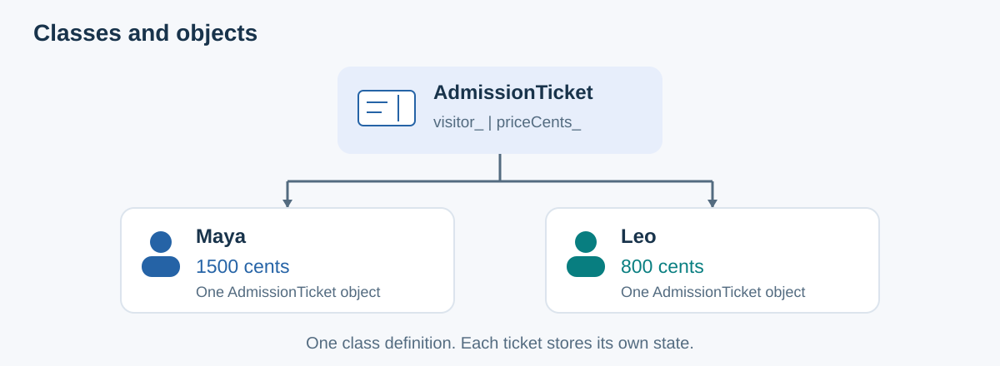
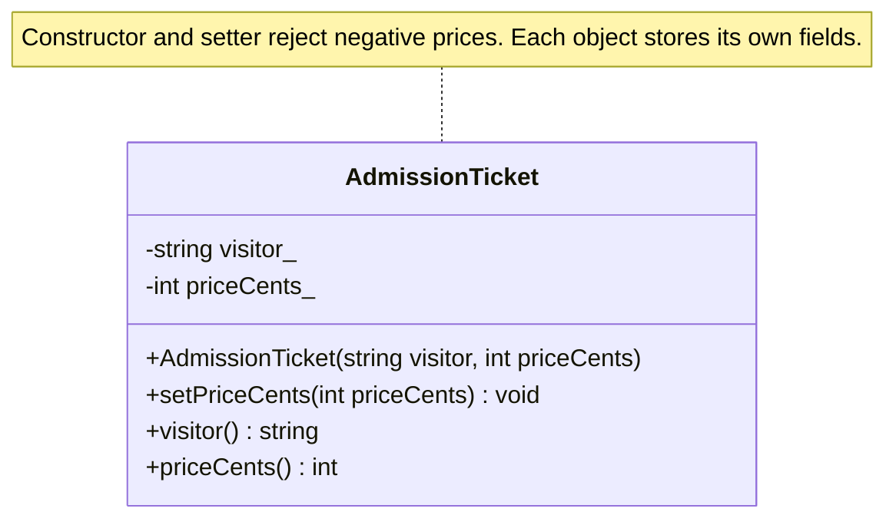
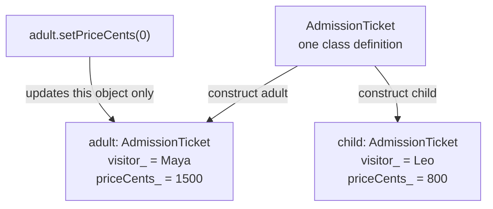
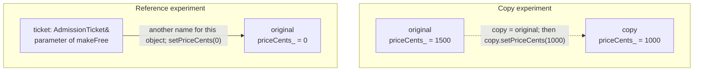

# Classes and Objects: Keep Related Things Together

**A class describes what an object stores and what it can do.** `AdmissionTicket` describes a ticket with a visitor name, a price, and functions for reading or changing those details.

**An object is one actual instance of a class.** Maya's ticket and Leo's ticket are two objects created from the same `AdmissionTicket` class. Each stores its own name and price.

All five notes use **museum admission tickets**: Maya (1500 cents), Leo (800 cents), and later Nora (1000 cents). Integer cents avoid floating-point rounding. Each complete program is independent and assumes the ticket category was chosen correctly at purchase.

| Note | What the ticket example teaches |
|------|---------------------------------|
| Classes and objects | Create separate tickets from one class |
| [Encapsulation](02_Encapsulation.md) | Keep ticket prices valid through checked operations |
| [Abstraction](03_Abstraction.md) | Print a receipt using a ticket's public operations |
| [Inheritance](04_Inheritance.md) | Share admission rules across ticket kinds and add guided-tour check-in |
| [Polymorphism](05_Polymorphism.md) | Let one receipt function get each ticket kind's own price |

## Contents

1. [Think of a ticket template](#1-think-of-a-ticket-template)
2. [Why do we need classes?](#2-why-do-we-need-classes)
3. [A complete example with a class](#3-a-complete-example-with-a-class)
4. [One class, separate objects](#4-one-class-separate-objects)
5. [Copies and references](#5-copies-and-references)
6. [When does an object go away?](#6-when-does-an-object-go-away)
7. [The key intents](#7-the-key-intents)
8. [Common mistakes](#8-common-mistakes)
9. [Before writing a class](#9-before-writing-a-class)
10. [Check your understanding](#10-check-your-understanding)

For quick visual revision: [class design](#class-diagram-the-ticket-description) → [separate instances](#object-diagram-one-class-two-tickets) → [copies and references](#object-diagram-copy-versus-reference).

## 1. Think of a ticket template

One ticket class defines the fields and operations; each issued ticket has its own values.



## 2. Why do we need classes?

Suppose you track two tickets without a class:

```cpp
#include <iostream>
#include <string>

int main() {
    std::string adultVisitor = "Maya";
    int adultPriceCents = 1500;

    std::string childVisitor = "Leo";
    int childPriceCents = 800;

    childPriceCents = adultPriceCents; // Bug: copied the wrong price.
    adultPriceCents = -100;           // Bug: a price cannot be negative.

    std::cout << adultVisitor << ": " << adultPriceCents << " cents\n";
    std::cout << childVisitor << ": " << childPriceCents << " cents\n";
}
```

Output:

```text
Maya: -100 cents
Leo: 1500 cents
```

The variables are separate. Nothing groups each visitor with their price or checks the price when it changes.

A class groups each visitor name with its price and can provide a function that checks price changes. Our class below rejects negative prices.

That check cannot catch every mistake: 1500 is a valid price even if you meant to set 800. The later chapters give adult and child tickets separate functions that return their fixed prices.

## 3. A complete example with a class

C++11 or newer. The constructor and setter enforce a nonnegative price.

```cpp
#include <iostream>
#include <stdexcept>
#include <string>

class AdmissionTicket {
public:
    AdmissionTicket(const std::string& visitor, int priceCents)
        : visitor_(visitor), priceCents_(priceCents) {
        if (priceCents_ < 0) {
            throw std::invalid_argument("Price must not be negative");
        }
    }

    void setPriceCents(int priceCents) {
        if (priceCents < 0) {
            throw std::invalid_argument("Price must not be negative");
        }
        priceCents_ = priceCents;
    }

    std::string visitor() const {
        return visitor_;
    }

    int priceCents() const {
        return priceCents_;
    }

private:
    std::string visitor_;
    int priceCents_;
};

int main() {
    AdmissionTicket adult("Maya", 1500);
    AdmissionTicket child("Leo", 800);

    std::cout << adult.visitor() << ": " << adult.priceCents() << " cents\n";
    std::cout << child.visitor() << ": " << child.priceCents() << " cents\n";
}
```

Output:

```text
Maya: 1500 cents
Leo: 800 cents
```

### Class diagram: the ticket description

`+` means public, `-` means private; `string` represents `std::string`.



**Recall question:** Does this class box represent Maya's ticket? It describes the type; Maya's ticket is one object created from it.

### 3.1 State and construction

Non-static fields belong to each object; `static` fields are shared by the class. The initializer list initializes fields before the constructor body runs. A negative starting price throws, so no completed ticket is created; zero is valid.

## 4. One class, separate objects

`adult` and `child` use the same functions but have separate stored values.

| Object | Visitor | Price |
|--------|---------|-------|
| `adult` | Maya | 1500 cents |
| `child` | Leo | 800 cents |

### Object diagram: one class, two tickets

The arrows mean “create an instance of”; they are not inheritance arrows. Both objects have the same C++ type.



The boxes show the initial values. After the shown setter call, Maya's price becomes zero and Leo's remains 800.

**Recall question:** Are `adult` and `child` different classes here? No—they are names of separate `AdmissionTicket` objects.

Adding another ticket takes one line:

```cpp
AdmissionTicket senior("Nora", 1000);
```

You do not need to write another `visitor()` or `priceCents()` function.

## 5. Copies and references

The following snippets use the class from section 3. Each experiment starts with a fresh ticket.

For this class, copying a ticket creates a separate object with the same starting values:

```cpp
AdmissionTicket original("Maya", 1500);
AdmissionTicket copy = original;
copy.setPriceCents(1000);

std::cout << original.priceCents() << ' ' << copy.priceCents();
```

This prints `1500 1000`. Changing the copy does not change the original.

A function parameter without `&` receives a copy of the ticket. This is called **passing by value**:

```cpp
void makeFree(AdmissionTicket ticket) {
    ticket.setPriceCents(0);
}
```

`ticket` is a copy. Calling `makeFree(original)` will not change `original`.

To work with the original ticket, replace that function with:

```cpp
void makeFree(AdmissionTicket& ticket) {
    ticket.setPriceCents(0);
}
```

A **reference**, written with `&`, is another name for an existing object. Now `makeFree(original)` changes the original ticket's price to zero.

Use `const AdmissionTicket&` when a function should read the existing ticket without changing it or making a copy.

### Object diagram: copy versus reference

These are two separate experiments, each starting with `original` priced at 1500 cents. The diagram shows the results after the indicated change.



**Recall question:** Which experiment changes the caller's ticket? The reference experiment; the value experiment changes a separate copy.

## 6. When does an object go away?

Local objects are destroyed when execution leaves their scope. The compiler-generated destructor is sufficient for this class and cleans up its stored string.

### 6.1 References do not keep an object alive

A reference parameter does not own the ticket or extend its lifetime. Using a saved reference after the ticket is destroyed is undefined behavior: the reference is dangling.

## 7. The key intents

- Group related state and operations in a meaningful type.
- Reuse one class definition while keeping object state separate.
- Establish valid state during construction and preserve it during updates.

## 8. Common mistakes

### 8.1 Forgetting starting values

Give every stored number a starting value. Writing `int priceCents_;` alone does not guarantee zero. Our constructor sets it from the supplied price, so later reads use a known value.

### 8.2 Letting one class do too much

A ticket stores ticket details and enforces its rules. Saving files, sending receipts, and drawing screens can be handled separately.

### 8.3 Expecting a copy to change the original

Use `AdmissionTicket&` when a function must change an existing ticket.

### 8.4 Forgetting const on functions that only read

`priceCents() const` can be called through a `const AdmissionTicket&`. Without the ending `const`, C++ rejects that call because the function has not promised to leave the ticket unchanged.

### 8.5 Choosing class or struct by habit

Both can store data and have functions. Members of a `struct` are public by default; members of a `class` are private by default.

A `struct` can be useful for a freely editable draft of receipt text. A `class` is useful for a ticket whose price changes need checks.

## 9. Before writing a class

1. Name the thing you are describing.
2. List the values each object needs to store.
3. List the actions it needs to provide.
4. Give every stored value a sensible starting value.
5. Check rules when the object is created and when its data changes.
6. Use `const` on functions that only read.
7. Keep unrelated work outside the class.

## 10. Check your understanding

**What is the difference between a class and an object?**

<details>
<summary>Answer</summary>

`AdmissionTicket` is the description of a ticket. `adult` and `child` are two actual tickets made from that description, each with its own visitor and price.

</details>

**If you change Maya's price, does Leo's price change too?**

<details>
<summary>Answer</summary>

No. Each ticket has its own `priceCents_`.

</details>

**What does the constructor do?**

<details>
<summary>Answer</summary>

It initializes the visitor and price, and rejects a negative price.

</details>

**Why does `makeFree(AdmissionTicket ticket)` leave the original unchanged?**

<details>
<summary>Answer</summary>

It receives a copy. Use `AdmissionTicket&` to change the original.

</details>

## Sources and further reading

- Wikipedia: [Classes](https://en.wikipedia.org/wiki/Class_(computer_programming))
- cppreference: [C++ classes](https://en.cppreference.com/w/cpp/language/classes)
- C++ Core Guidelines: [Organize related data together](https://isocpp.github.io/CppCoreGuidelines/CppCoreGuidelines#rc-org)
- C++ Core Guidelines: [Set up objects completely](https://isocpp.github.io/CppCoreGuidelines/CppCoreGuidelines#rc-complete)
