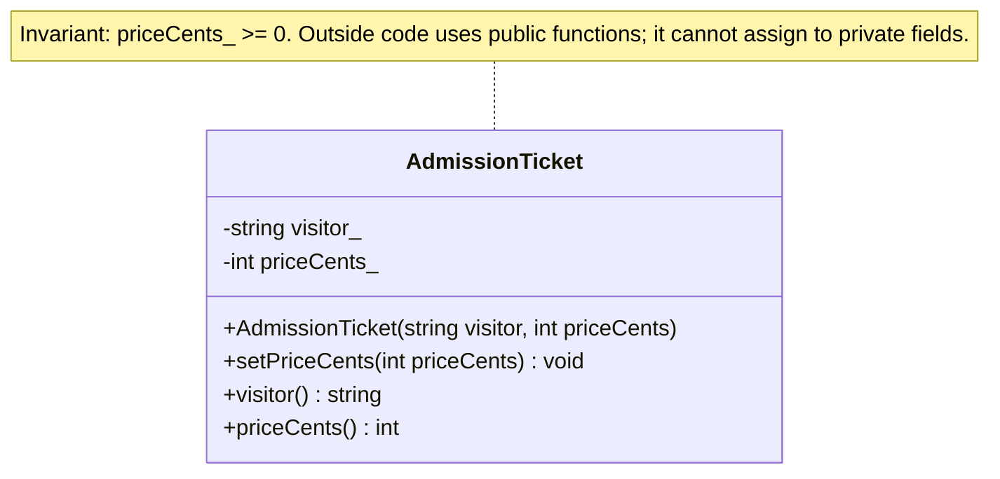
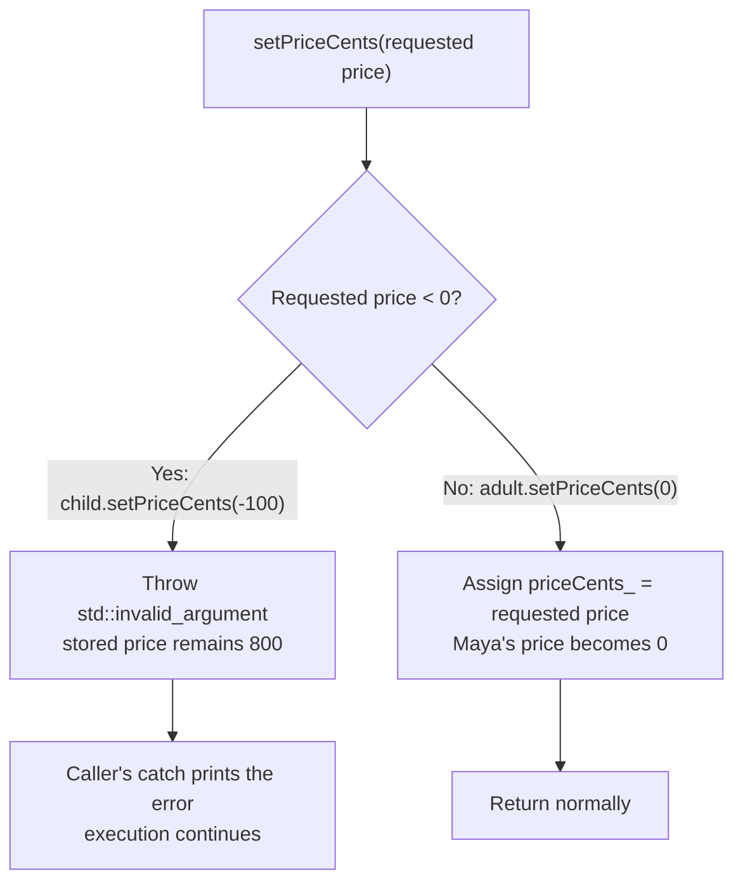
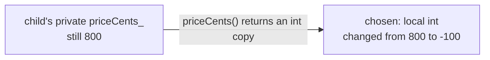

# Encapsulation: Let an Object Protect Its Data

**Encapsulation keeps an object's data and the functions that use it together, and controls how other code can access that data.** A ticket stores its price and checks requests to change it.

**Data hiding** means preventing other code from directly reading or changing selected fields. `private` hides the stored ticket price, so callers must use the functions the ticket provides.

We continue with the museum's `AdmissionTicket` from [Classes and Objects](01_ClassesAndObjects.md): Maya's ticket starts at 1500 cents and Leo's at 800 cents. This note focuses on the rule that a ticket price must never be negative. Zero is valid for a free ticket.

## Contents

1. [Think of changing a ticket at the museum counter](#1-think-of-changing-a-ticket-at-the-museum-counter)
2. [The problem with directly changing data](#2-the-problem-with-directly-changing-data)
3. [Put the checks inside the class](#3-put-the-checks-inside-the-class)
4. [Private alone is not enough](#4-private-alone-is-not-enough)
5. [Reading data without giving away control](#5-reading-data-without-giving-away-control)
6. [The key intents](#6-the-key-intents)
7. [Request a checked action](#7-request-a-checked-action)
8. [How is this different from abstraction?](#8-how-is-this-different-from-abstraction)
9. [Common mistakes](#9-common-mistakes)
10. [Before writing the class](#10-before-writing-the-class)
11. [Check your understanding](#11-check-your-understanding)

For quick visual revision: [public operations and private fields](#class-diagram-the-controlled-access-points) → [validation before assignment](#31-validation-before-assignment) → [reading a value copy](#object-diagram-reading-does-not-give-write-access).

## 1. Think of changing a ticket at the museum counter

A staff member asks the ticket system to change a price. The system checks the new value before accepting it.

In code:

- The stored price is `private`: outside code cannot change it directly.
- `setPriceCents()` is `public`: outside code can request a change.
- The constructor and setter both reject negative prices.

The ticket checks the price in one place. Receipt code and counter code can use that check instead of each writing their own.

## 2. The problem with directly changing data

```cpp
#include <iostream>
#include <string>

struct AdmissionTicket {
    std::string visitor;
    int priceCents;
};

int main() {
    AdmissionTicket adult{"Maya", 1500};
    adult.priceCents = -100;

    std::cout << adult.visitor << ": " << adult.priceCents << " cents\n";
}
```

Output:

```text
Maya: -100 cents
```

There is no check to stop the assignment. If many parts of the program change `priceCents` directly, every one must remember the rule. Forget it once, and the ticket stores an invalid price.

With a public field, `adult.priceCents = -100` stores the negative number immediately. With a checked function, the ticket can reject that request before its stored price changes.

## 3. Put the checks inside the class

C++11 or newer. This uses the ticket class from [Classes and Objects](01_ClassesAndObjects.md): starting prices and price changes must be nonnegative.

```cpp
#include <iostream>
#include <stdexcept>
#include <string>

class AdmissionTicket {
public:
    AdmissionTicket(const std::string& visitor, int priceCents)
        : visitor_(visitor), priceCents_(priceCents) {
        if (priceCents_ < 0) {
            throw std::invalid_argument("Price must not be negative");
        }
    }

    void setPriceCents(int priceCents) {
        if (priceCents < 0) {
            throw std::invalid_argument("Price must not be negative");
        }
        priceCents_ = priceCents;
    }

    std::string visitor() const {
        return visitor_;
    }

    int priceCents() const {
        return priceCents_;
    }

private:
    std::string visitor_;
    int priceCents_;
};

int main() {
    AdmissionTicket adult("Maya", 1500);
    AdmissionTicket child("Leo", 800);

    std::cout << adult.visitor() << ": " << adult.priceCents() << " cents\n";
    std::cout << child.visitor() << ": " << child.priceCents() << " cents\n";

    adult.setPriceCents(0);
    std::cout << adult.visitor() << ": " << adult.priceCents() << " cents\n";

    try {
        child.setPriceCents(-100);
    } catch (const std::invalid_argument& error) {
        std::cout << error.what() << '\n';
    }

    std::cout << child.visitor() << ": " << child.priceCents() << " cents\n";
}
```

Output:

```text
Maya: 1500 cents
Leo: 800 cents
Maya: 0 cents
Price must not be negative
Leo: 800 cents
```

### Class diagram: the controlled access points

`+` means public, `-` means private; `string` represents `std::string`.



**Recall question:** Does `private` alone keep the price valid? No—the constructor and every operation that changes the price must enforce the invariant.

A failed constructor leaves no completed ticket. A rejected setter request leaves the existing price unchanged.

### 3.1 Validation before assignment



**Recall question:** Why does Leo's price remain 800? The setter throws before the assignment.

### 3.2 Public operations

Outside code uses the checked setter and read-only getters.

Intentional compile error:

```cpp
child.priceCents_ = -100; // Error: priceCents_ is private.
```

## 4. Private alone is not enough

Suppose we replace the checked setter with this unchecked version:

```cpp
void setPriceCents(int priceCents) {
    priceCents_ = priceCents;
}
```

Now `child.setPriceCents(-100)` accepts a bad value even though the data is still private.

A function that sets a value is often called a **setter**. Setters are useful when callers need to choose a value, but they must enforce the rules. The checked version in the complete program does that before changing the stored price.

A **class invariant** is a rule every usable object must keep. Our rule is `priceCents_ >= 0`: a ticket price must be zero or more cents.

The constructor checks that a new ticket follows the rule. The setter checks that a changed ticket still follows it. A rejected request leaves the old valid price in place.

Every way of changing the data must follow the rules. Private access by itself cannot guarantee this.

## 5. Reading data without giving away control

The example's `priceCents()` function returns a copy of the stored number:

```cpp
int chosen = child.priceCents();
chosen = -100;
```

Changing `chosen` does not change `child`. They are separate values.

### Object diagram: reading does not give write access

This shows the state after the two lines above, using Leo's 800-cent ticket.



There is no reference back to the field: assigning to `chosen` changes only the local number.

**Recall question:** Why would returning `int&` be different? It would let callers write directly to the stored price and bypass the setter's check.

Be careful about replacing the getter with this version:

```cpp
int& priceCents() {
    return priceCents_;
}
```

`child.priceCents() = -100` would then bypass validation by assigning through the returned reference.

Returning an `int` gives the caller a separate number, so changing it cannot change the ticket. A function returning `const int&` would let the caller read the stored number through a reference but not assign to it through that reference. For this small number, a copy is simpler.

## 6. The key intents

- Centralize validation in the class instead of repeating checks in callers.
- Keep all state-changing operations responsible for the invariant.
- Return value copies when callers do not need access to internal storage.

## 7. Request a checked action

```cpp
child.setPriceCents(800);
```

Callers request changes; the class validates them. A fixed-category design may remove the setter, which would require changes to callers that edit prices.

## 8. How is this different from abstraction?

| Idea | What it helps with | Ticket example |
|------|--------------------|----------------|
| **Encapsulation** | Keeping price changes under the ticket's control | `priceCents_` is private and changes go through a checked setter |
| **Abstraction** | Letting receipt code request a price without learning how it is produced | A receipt calls `priceCents()` without knowing how the price is stored or calculated |

See [Abstraction](03_Abstraction.md) for the next topic.

## 9. Common mistakes

- **Checking changes but not starting values:** the constructor must reject a negative price too.
- **Adding an unchecked setter:** private data does not help if a public function accepts any value.
- **Returning `int&` from the price getter:** callers can change the stored price without using the checked setter.
- **Getting the zero case wrong:** zero is a valid free ticket; a negative request must fail and leave the old price unchanged.
- **Adding unnecessary restrictions:** freely editable draft receipt text may be fine in a `struct`; ticket price rules need checked operations.

## 10. Before writing the class

1. List the data the object stores.
2. Write its rules in plain words, such as "the price is zero or more cents."
3. Keep data private when outside changes need to be controlled.
4. Check starting values in the constructor.
5. Provide the actions other code needs.
6. Check that every function that changes a stored value keeps that value valid.
7. Let callers read what they need without giving them an unchecked way to change it.

## 11. Check your understanding

**Why is a public price variable a problem here?**

<details>
<summary>Answer</summary>

Any code can assign a negative price without checking the rule.

</details>

**Does making the price private automatically fix everything?**

<details>
<summary>Answer</summary>

No. An unchecked public setter or a getter returning `int&` can still let invalid values through.

</details>

**What happens when `child.setPriceCents(-100)` is called?**

<details>
<summary>Answer</summary>

The checked setter throws before assignment. Leo's price stays at 800 cents. The caller must handle the exception if execution should continue.

</details>

**Why return `int` from `priceCents()` instead of `int&`?**

<details>
<summary>Answer</summary>

Returning `int` gives the caller a copy. Returning `int&` lets the caller change the stored price directly.

</details>

**Is a struct always a bad choice?**

<details>
<summary>Answer</summary>

No. It can suit freely editable data. Use checked operations when changes must follow rules; a struct can also have private members and functions if explicitly declared that way.

</details>

## Sources and further reading

- Wikipedia: [Encapsulation](https://en.wikipedia.org/wiki/Encapsulation_(computer_programming))
- Martin Fowler: [Keeping actions with the data they use](https://martinfowler.com/bliki/TellDontAsk.html)
- C++ Core Guidelines: [Limit direct access to members](https://isocpp.github.io/CppCoreGuidelines/CppCoreGuidelines#rc-private)
- C++ Core Guidelines: [Set up objects completely](https://isocpp.github.io/CppCoreGuidelines/CppCoreGuidelines#rc-complete)
