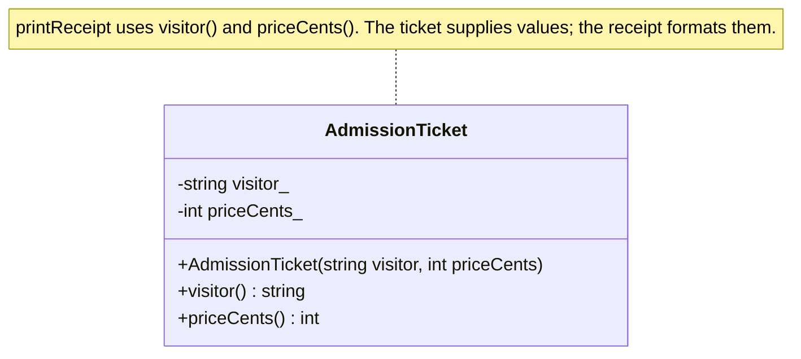
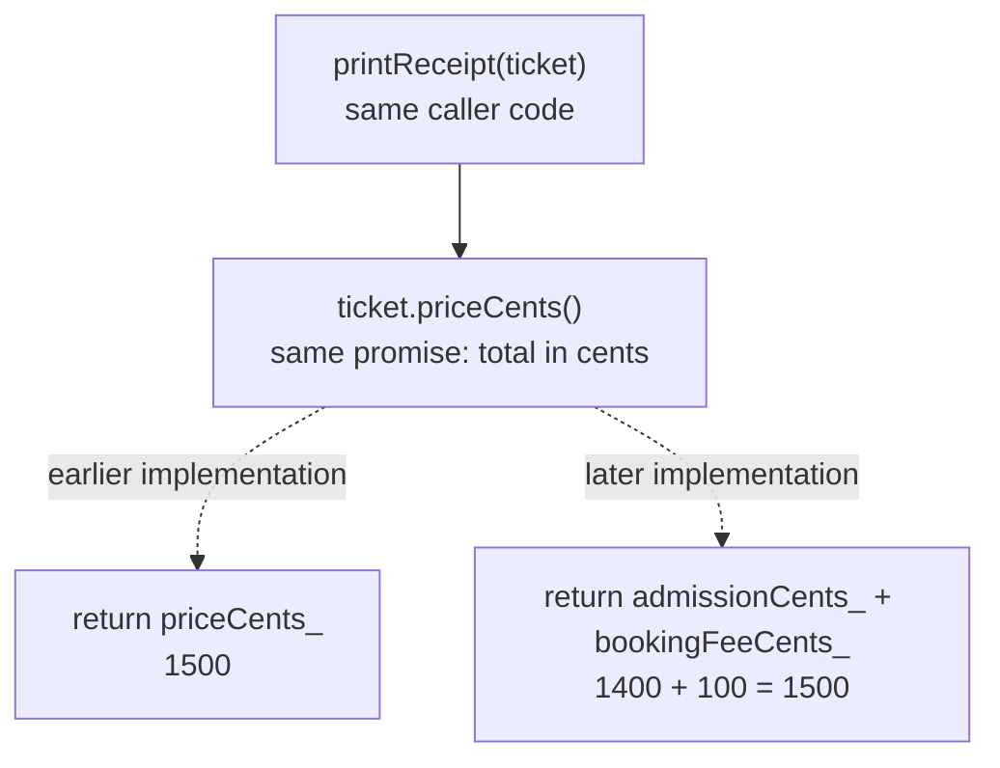

# Abstraction: Show What Matters

**Abstraction means giving code a useful function to call without making it understand all the steps inside that function** [1]. A receipt calls `priceCents()` to get the ticket price; the ticket decides how to produce that number.

We continue with the same museum admission tickets: Maya pays 1500 cents and Leo pays 800 cents. A receipt needs each visitor's name and price. It does not need to know how a ticket stores those details.

## Contents

1. [Start with the museum receipt](#1-start-with-the-museum-receipt)
2. [Bad vs. good: a receipt that depends on ticket storage](#2-bad-vs-good-a-receipt-that-depends-on-ticket-storage)
3. [The key intents](#3-the-key-intents)
4. [Common mistakes](#4-common-mistakes)
5. [A short design checklist](#5-a-short-design-checklist)
6. [Check your understanding](#6-check-your-understanding)

For quick visual revision: [the ticket interface](#class-diagram-what-the-receipt-can-request) → [receipt call sequence](#sequence-diagram-ask-for-results-then-format-them) → [changing the implementation](#dependency-diagram-same-request-different-storage).

## 1. Start with the museum receipt

At the museum counter, the receipt printer asks a ticket for:

- The visitor's name: `visitor()`.
- The price in cents: `priceCents()`.

Those operations describe **what the printer needs**. The ticket handles **how to supply it**.

The receipt programmer can read the ticket code if needed, but does not need to study it every time a receipt is printed. Calling the price function is enough.

### 1.1 You already use abstraction in code

```cpp
printReceipt(adult);
```

A well-named function provides abstraction without requiring inheritance or an abstract class.

## 2. Bad vs. good: a receipt that depends on ticket storage

### 2.1 A receipt that reads internal fields

This complete program works:

```cpp
#include <iostream>
#include <string>

struct AdmissionTicket {
    std::string visitor;
    int priceCents;
};

void printReceipt(const AdmissionTicket& ticket) {
    std::cout << ticket.visitor << ": " << ticket.priceCents << " cents\n";
}

int main() {
    AdmissionTicket adult{"Maya", 1500};
    AdmissionTicket child{"Leo", 800};

    printReceipt(adult);
    printReceipt(child);
}
```

Output:

```text
Maya: 1500 cents
Leo: 800 cents
```

This receipt reads `ticket.priceCents` directly, so it needs that exact field to exist. If the ticket later calculates its price instead of storing that field, the receipt must change. Refund and report code reading the same field would need edits too.

Public fields can suit a simple record that callers are allowed to edit freely. Here, we want receipt code to keep asking for a price even if the way the ticket produces it changes.

### 2.2 A receipt that asks for ticket details

C++11 or newer. This version assumes valid input and has no setter; [Encapsulation](02_Encapsulation.md) covers price validation.

```cpp
#include <iostream>
#include <string>

class AdmissionTicket {
public:
    AdmissionTicket(const std::string& visitor, int priceCents)
        : visitor_(visitor), priceCents_(priceCents) {}

    std::string visitor() const {
        return visitor_;
    }

    int priceCents() const {
        return priceCents_;
    }

private:
    std::string visitor_;
    int priceCents_;
};

void printReceipt(const AdmissionTicket& ticket) {
    std::cout << ticket.visitor() << ": "
              << ticket.priceCents() << " cents\n";
}

int main() {
    AdmissionTicket adult("Maya", 1500);
    AdmissionTicket child("Leo", 800);

    printReceipt(adult);
    printReceipt(child);
}
```

Output:

```text
Maya: 1500 cents
Leo: 800 cents
```

The receipt depends on public operations rather than stored fields.

The practice file [2_Abstration.cpp](../../Practice/2_Abstration.cpp) names these functions `getVisitor()` and `getPriceCents()`. They serve the same purpose.

### Class diagram: what the receipt can request

`+` means public, `-` means private; `string` represents `std::string`.



`printReceipt()` is a free function, not a member of the ticket. Its parameter is `const AdmissionTicket&`.

**Recall question:** Does abstraction require a pure virtual function? No—this ordinary class already provides useful requests that hide storage details.

### 2.3 Read the interface as a set of requests

An **interface** is the set of public operations and their promises.

| Operation | Meaning in this example |
|-----------|-------------------------|
| `visitor()` | Return the visitor's name |
| `priceCents()` | Return the price in whole cents |

C++ has no separate `interface` keyword. An ordinary class's public functions can provide an interface.

### Sequence diagram: ask for results, then format them

```mermaid
sequenceDiagram
    participant Main as main()
    participant Receipt as printReceipt(ticket)
    participant Ticket as adult: AdmissionTicket
    participant Output as std::cout

    Main->>Receipt: printReceipt(adult)
    Note over Receipt,Ticket: ticket refers to adult; no ticket copy is created
    Receipt->>Ticket: visitor()
    Ticket-->>Receipt: Maya
    Receipt->>Ticket: priceCents()
    Ticket-->>Receipt: 1500
    Receipt->>Output: Print Maya: 1500 cents
```

**Recall question:** Who decides how the price is calculated, and who prints it? The ticket supplies the price; the receipt prints the result.

## 3. The key intents

### 3.1 Reduce what you need to understand

You can read the receipt function without learning the ticket's storage or pricing rules.

### 3.2 Change details without breaking readers

Today, `priceCents()` returns one stored number. Suppose the museum later stores an admission amount and a booking fee separately. For Maya, 1400 cents plus a 100-cent fee still gives the same 1500-cent total.

Alternative implementations:

```cpp
// Earlier version: the ticket stores int priceCents_.
int priceCents() const {
    return priceCents_;
}
```

```cpp
// Later version: the ticket stores int admissionCents_ and int bookingFeeCents_.
int priceCents() const {
    return admissionCents_ + bookingFeeCents_;
}
```

The public request and its units stay the same, so the receipt needs no changes. No inheritance or virtual function is required.

### Dependency diagram: same request, different storage

These are alternative implementations at different stages, not two choices the receipt makes at runtime.



**Recall question:** What must stay consistent when storage changes? The public request and its promise, including the units returned.

## 4. Common mistakes

### 4.1 Making the caller perform the implementation steps

If receipt code reads ticket storage and calculates prices itself, it must understand those details. Put the calculation behind a useful operation such as `priceCents()`.

### 4.2 Using unclear names

`getValue()` does not say which value it returns. `priceCents()` explains both the value and its unit.

### 4.3 Keeping the name but breaking the promise

If `priceCents()` starts returning 15 dollars instead of 1500 cents, the receipt will print `15 cents`, which is wrong. Keep the function's name, units, and behavior consistent so callers can trust the result.

### 4.4 Assuming abstraction requires an abstract class

The ordinary ticket class already provides abstraction: callers ask for a price without reading its fields. An **abstract class** is a different C++ feature: a class you cannot create objects from directly. [Polymorphism](05_Polymorphism.md) explains that feature.

## 5. A short design checklist

1. Write down what callers need to ask for.
2. Name each operation after what it does.
3. Keep storage and calculation details inside the class or function.
4. Explain what each function returns, whether its number means cents or dollars, and when it can fail.
5. Try changing how the price is produced and check that the receipt can still call the same function.

## 6. Check your understanding

**What is hidden from the receipt function?**

<details>
<summary>Answer</summary>

How the ticket stores or calculates its price. The receipt only uses `visitor()` and `priceCents()`.

</details>

**What problem does reading public fields create here?**

<details>
<summary>Answer</summary>

Callers depend on those fields continuing to exist. Replacing stored prices with calculated prices would require changing those callers.

</details>

**Does abstraction always require an abstract class?**

<details>
<summary>Answer</summary>

No. `printReceipt()` and the ordinary ticket class already expose useful operations while hiding details.

</details>

**What does “the receipt only relies on the operations it needs” mean?**

<details>
<summary>Answer</summary>

The receipt uses the name and price functions to print its output. It does not directly use the ticket's stored fields or need to understand how those functions produce their results.

</details>

## Sources and further reading

- [1] Wikipedia: [Abstraction (computer science)](https://en.wikipedia.org/wiki/Abstraction_(computer_science)).
