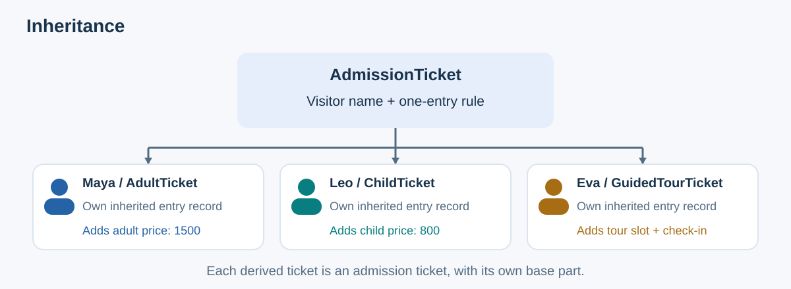
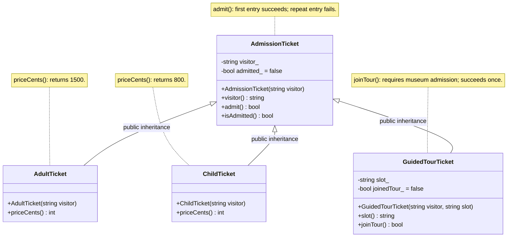
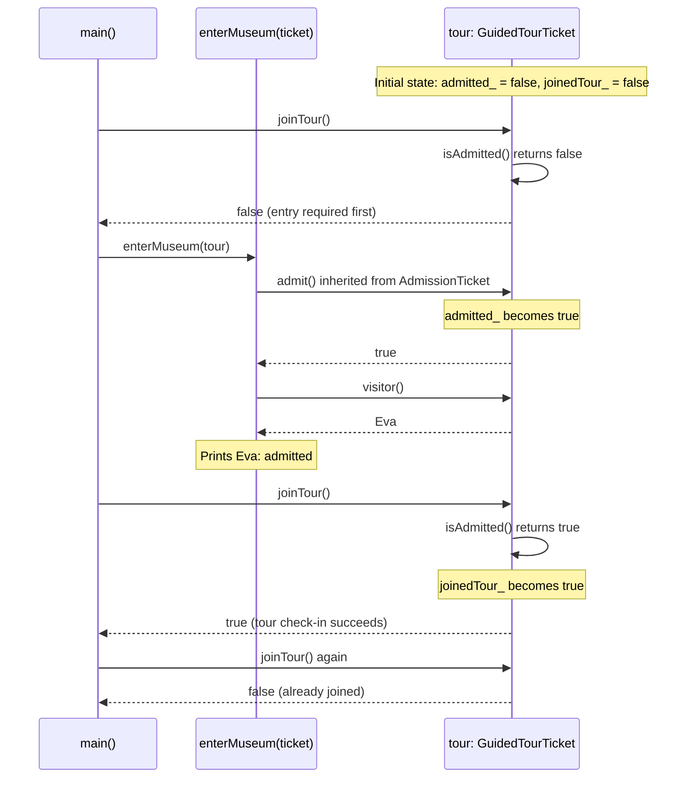
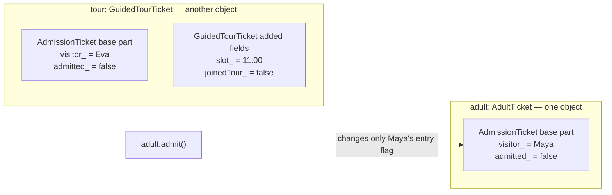
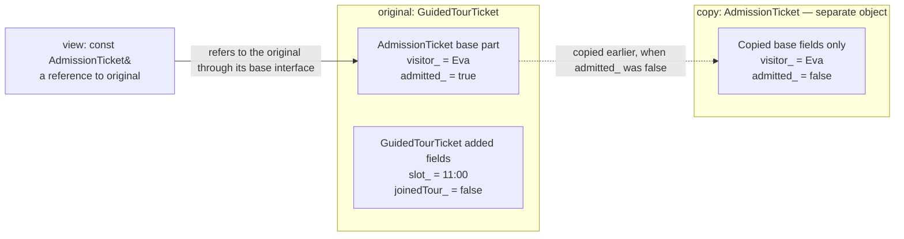

# Inheritance

Inheritance lets you create a class using another class as its starting point. For example, an adult ticket can reuse the name and entrance rules of an admission ticket, then add its adult price.

We continue the museum example from [Abstraction](03_Abstraction.md). Maya has an adult ticket, Leo has a child ticket, and Eva has a guided-tour ticket.

## Contents

1. [Meaning and basic syntax](#1-meaning-and-basic-syntax)
2. [The museum-ticket model](#2-the-museum-ticket-model)
3. [Without inheritance vs. with inheritance](#3-without-inheritance-vs-with-inheritance)
4. [Object structure and behavior](#4-object-structure-and-behavior)
5. [Access rules](#5-access-rules)
6. [Construction and destruction](#6-construction-and-destruction)
7. [Forms of inheritance](#7-forms-of-inheritance)
8. [Design rules and object slicing](#8-design-rules-and-object-slicing)
9. [Inheritance and polymorphism](#9-inheritance-and-polymorphism)
10. [Review and self-test](#10-review-and-self-test)

For a quick visual revision, follow the [class diagram](#lld-class-diagram) → [admission and tour sequence](#41-admission-and-tour-sequence) → [each object's stored state](#42-each-ticket-has-its-own-base-part) → [copying versus referencing](#83-avoid-slicing-when-working-with-derived-objects).

## 1. Meaning and basic syntax

### 1.1 What is inheritance?

**Inheritance means defining a new class that gets data and functions from an existing class and can add functions of its own** [1].

- **Base class:** the class you build on. `AdmissionTicket` stores a visitor name.
- **Derived class:** the class you create from that base. `AdultTicket` uses the stored name and adds an adult price.
- **Public inheritance:** code that accepts an admission ticket can also accept an adult ticket.

Minimal example:

```cpp
class AdmissionTicket {
public:
    explicit AdmissionTicket(const std::string& visitor) : visitor_(visitor) {}
    std::string visitor() const { return visitor_; }

private:
    std::string visitor_;
};

class AdultTicket : public AdmissionTicket {
public:
    explicit AdultTicket(const std::string& visitor) : AdmissionTicket(visitor) {}
    int priceCents() const { return 1500; }
};

// Inside a function:
AdultTicket adult("Maya");
adult.visitor();    // Inherited: "Maya".
adult.priceCents(); // Added by AdultTicket: 1500.
```

`AdultTicket` gets `visitor()` from `AdmissionTicket`, so it can read Maya's name without defining that function again. It adds `priceCents()` to return the adult price.

`AdmissionTicket(visitor)` initializes the base part. Public inheritance makes `AdultTicket` usable through `AdmissionTicket&`.

### 1.2 The “is-a” relationship

An adult ticket **is an** admission ticket: it must do everything the entrance expects an admission ticket to do. A guided-tour ticket makes the same promise and also provides a tour.

`AdmissionTicket&` exposes the base interface without copying the derived object.

Use inheritance when both ideas fit: the new class is a kind of the base class, and code written for the base can sensibly use the new class [2].



## 2. The museum-ticket model

### 2.1 Requirements

The museum has three kinds of ticket:

- `AdultTicket`: ordinary admission and an adult price of 1500 cents.
- `ChildTicket`: ordinary admission and a child price of 800 cents.
- `GuidedTourTicket`: ordinary admission plus access to its booked tour slot.

All three follow one entrance rule: **using a ticket to enter succeeds once; trying the same ticket again fails**. Eva must enter the museum before joining her tour, and her tour ticket can be checked in once.

Assume the visitors already bought valid tickets and Eva arrives for her booked tour time. The code below tracks two events: entering the museum and joining a tour.

### 2.2 Class responsibilities

| Class | What it stores | What its functions do |
|-------|----------------------|------------------------|
| `AdmissionTicket` | The visitor name and whether this ticket has already admitted its holder | `visitor()` reads the name; `admit()` tries to enter; `isAdmitted()` checks whether entry has happened |
| `AdultTicket` | Keeps its name and entry record in its base part | Adds `priceCents()` to return 1500 cents |
| `ChildTicket` | Keeps its name and entry record in its base part | Adds `priceCents()` to return 800 cents |
| `GuidedTourTicket` | Keeps its name and entry record in its base part; adds a tour time and whether it has joined the tour | Adds `slot()` to read the booked time and `joinTour()` to try checking into the tour |

#### LLD class diagram

Section 3.2 class design. `+` means public, `-` means private; `string` represents `std::string`.



The hollow triangle points to the base class. Each derived ticket inherits the public admission operations and contains its own base fields; those private fields are accessed through the base's functions. Only the additional members are listed in each derived class.

`enterMuseum(AdmissionTicket& ticket)` is a free function, so it is not a class box. It accepts any of the three derived tickets through a base reference and calls `admit()` and `visitor()` on the original object. `priceCents()` belongs to the adult and child classes; `slot()` and `joinTour()` belong to the guided-tour class.

The entrance uses `admit()`; the tour desk additionally needs `joinTour()`. Section 3.2 is a complete C++11 program; other class sketches are separate examples.

## 3. Without inheritance vs. with inheritance

### 3.1 Without inheritance: repeated state and rules

Here, adult and child tickets are separate classes with no base class. Each stores its own copy of the same fields and defines the same entrance rule:

```cpp
class AdultTicket {
public:
    explicit AdultTicket(const std::string& visitor) : visitor_(visitor) {}
    std::string visitor() const { return visitor_; }

    bool admit() {
        if (admitted_) return false;
        admitted_ = true;
        return true;
    }

    int priceCents() const { return 1500; }

private:
    std::string visitor_;
    bool admitted_ = false;
};

class ChildTicket {
public:
    explicit ChildTicket(const std::string& visitor) : visitor_(visitor) {}
    std::string visitor() const { return visitor_; }

    bool admit() { // Same rule written again.
        if (admitted_) return false;
        admitted_ = true;
        return true;
    }

    int priceCents() const { return 800; }

private:
    std::string visitor_; // Same storage written again.
    bool admitted_ = false;
};
```

A guided-tour class without inheritance would need a third copy of the shared state and admission rule.

If the admission rule changed, you would have to update all three functions. Matching function names also do not connect these classes: C++ needs an actual inheritance declaration to let an adult or child ticket be passed as an `AdmissionTicket&`.

### 3.2 With inheritance: one shared admission implementation

This program puts the shared name and entry rule in `AdmissionTicket`. Each derived class keeps only what it adds.

Complete program:

```cpp
#include <iostream>
#include <string>

class AdmissionTicket {
public:
    explicit AdmissionTicket(const std::string& visitor) : visitor_(visitor) {}

    std::string visitor() const {
        return visitor_;
    }

    bool admit() {
        if (admitted_) {
            return false;
        }
        admitted_ = true;
        return true;
    }

    bool isAdmitted() const {
        return admitted_;
    }

private:
    std::string visitor_;
    bool admitted_ = false;
};

class AdultTicket : public AdmissionTicket {
public:
    explicit AdultTicket(const std::string& visitor) : AdmissionTicket(visitor) {}

    int priceCents() const {
        return 1500;
    }
};

class ChildTicket : public AdmissionTicket {
public:
    explicit ChildTicket(const std::string& visitor) : AdmissionTicket(visitor) {}

    int priceCents() const {
        return 800;
    }
};

class GuidedTourTicket : public AdmissionTicket {
public:
    GuidedTourTicket(const std::string& visitor, const std::string& slot)
        : AdmissionTicket(visitor), slot_(slot) {}

    std::string slot() const {
        return slot_;
    }

    bool joinTour() {
        if (!isAdmitted() || joinedTour_) {
            return false;
        }
        joinedTour_ = true;
        return true;
    }

private:
    std::string slot_;
    bool joinedTour_ = false;
};

void enterMuseum(AdmissionTicket& ticket) {
    bool entered = ticket.admit();
    std::cout << ticket.visitor()
              << (entered ? ": admitted\n" : ": already admitted\n");
}

int main() {
    AdultTicket adult("Maya");
    ChildTicket child("Leo");
    GuidedTourTicket tour("Eva", "11:00");

    std::cout << adult.priceCents() << ' ' << child.priceCents() << " cents\n";

    std::cout << "Tour before admission: "
              << (tour.joinTour() ? "joined" : "denied") << '\n';

    enterMuseum(adult);
    enterMuseum(child);
    enterMuseum(tour);  // The same entrance accepts every ticket kind.
    enterMuseum(adult); // The inherited rule prevents a second admission.

    std::cout << tour.visitor() << ": tour at " << tour.slot() << ' '
              << (tour.joinTour() ? "joined" : "denied") << '\n';
    std::cout << "Second tour check-in: "
              << (tour.joinTour() ? "joined" : "denied") << '\n';
}
```

Output:

```text
1500 800 cents
Tour before admission: denied
Maya: admitted
Leo: admitted
Eva: admitted
Maya: already admitted
Eva: tour at 11:00 joined
Second tour check-in: denied
```

**Why inheritance helps here:** `enterMuseum()` accepts all three ticket kinds and calls the same admission function for each. The tour class adds its booked time and check-in rule, and reads the existing entry record through `isAdmitted()`.

The adult and child prices stay the same as in earlier chapters. Different price numbers alone could be stored in one ticket class; the tour example shows a class adding something it can do.

## 4. Object structure and behavior

### 4.1 Admission and tour sequence

#### Sequence diagram: which call changes which state?

Inherited admission functions and tour functions operate on the same `tour` object.



**Recall question:** Why can Eva enter normally even though she cannot join the tour yet? The extra requirement belongs to `joinTour()`; the inherited `admit()` rule stays the same for every ticket.

### 4.2 Each ticket has its own base part

Eva's tour ticket contains the fields defined by `AdmissionTicket` as well as the fields defined by `GuidedTourTicket`. The admission portion inside her object is called a **base-class subobject**.

These diagrams show Maya's and Eva's tickets just after they are created, before either visitor enters:



Both tickets use the same `admit()` code, but each has its own stored name and entry flag. Changing Maya's entry flag leaves Eva's flag unchanged.

The boxes group fields by the class that declares them; they do not show exact byte layout in memory. Eva's base and derived parts belong to one complete object, and the private base fields still exist inside it.

**Recall question:** Does inheritance share one admission flag across all tickets? No—each object contains its own base part.

### 4.3 The base interface exposes shared operations

A tour ticket can call the admission functions it inherits and the tour functions it adds. Code using an `AdmissionTicket&` can only ask for functions declared in the admission class:

```cpp
GuidedTourTicket tour("Eva", "11:00");
tour.admit();    // Valid: inherited base operation.
tour.joinTour(); // Valid: guided-tour-specific operation.

AdmissionTicket& ticket = tour;
ticket.visitor(); // Valid: declared in the base.
// ticket.joinTour(); // Error: the base has no such operation.
```

`ticket` and `tour` refer to the same object. Using the name `ticket` limits you to admission functions; using the name `tour` also lets you call tour functions.

## 5. Access rules

### 5.1 Member access: public, protected, and private

`GuidedTourTicket` cannot directly access `visitor_` or `admitted_`. It uses `visitor()` and `isAdmitted()` instead.

```cpp
// Inside a GuidedTourTicket member function:
// if (!admitted_) return false; // Error: private in AdmissionTicket.
if (!isAdmitted()) return false; // Valid: uses the base's public operation.
```

For public inheritance (`GuidedTourTicket : public AdmissionTicket`):

| Access level in `AdmissionTicket` | Inside `GuidedTourTicket` methods | Outside the classes (e.g. `main()`) |
|----------------------------------|----------------------------------|-----------------------------------|
| `public` | Can access | Can access |
| `protected` | Can use on their own object | Cannot access |
| `private` | Cannot access directly | Cannot access directly |

`private` means only functions belonging to `AdmissionTicket` can directly read or change its private fields in these examples. Those fields still exist inside the tour ticket.

The tour class calls `isAdmitted()` to read the entry flag and inherits `admit()` to record entry. It cannot bypass that rule by assigning to `admitted_` directly.

`protected` lets a derived class use a helper on its own object while keeping that helper hidden from callers. It does not let derived code access protected members through just any `AdmissionTicket` object.

Here is a separate badge-printing example. The tour class can use the protected name-printing helper, while outside code calls the public `printTourBadge()`. Add `<iostream>` and `<string>` to use these definitions:

```cpp
class AdmissionTicket {
public:
    explicit AdmissionTicket(const std::string& visitor) : visitor_(visitor) {}

protected:
    void printVisitorBadge() const { std::cout << visitor_; }

private:
    std::string visitor_;
};

class GuidedTourTicket : public AdmissionTicket {
public:
    explicit GuidedTourTicket(const std::string& visitor) : AdmissionTicket(visitor) {}

    void printTourBadge() const {
        printVisitorBadge(); // Derived code can call the protected helper.
        std::cout << " - guided tour\n";
    }
};

// Inside a function:
GuidedTourTicket tour("Eva");
tour.printTourBadge(); // Eva - guided tour
// tour.printVisitorBadge(); // Error: outside code cannot call the helper.
```

### 5.2 Inheritance access: public, protected, and private

The word after the inheritance colon controls how other code can use the base through the derived class. In this table, `B` means the base class and `D` means the derived class:

| Declaration | Base's public members become | Base's protected members become | Can outside code pass a `D` object to a function taking `B&`? |
|-------------|------------------------------|---------------------------------|------------------------------------------------------|
| `class D : public B` | Public in `D` | Protected in `D` | Yes |
| `class D : protected B` | Protected in `D` | Protected in `D` | No |
| `class D : private B` | Private in `D` | Private in `D` | No |

None of these choices gives `D` direct access to private fields declared in `B`.

```cpp
class HiddenTicket : AdmissionTicket { // Defaults to private inheritance.
public:
    explicit HiddenTicket(const std::string& visitor) : AdmissionTicket(visitor) {}
};

class PublicTicket : public AdmissionTicket {
public:
    explicit PublicTicket(const std::string& visitor) : AdmissionTicket(visitor) {}
};

// Inside a function:
HiddenTicket hidden("Maya");
PublicTicket publicTicket("Leo");
// enterMuseum(hidden); // Error: the base conversion is inaccessible here.
enterMuseum(publicTicket); // Valid with public inheritance.
```

`HiddenTicket : AdmissionTicket` leaves out `public`, so it uses private inheritance. That is why `enterMuseum(hidden)` fails to compile. Write `: public AdmissionTicket` when you want the entrance to accept that ticket.

The default depends on the keyword: `class` uses private inheritance when no access word is given; `struct` uses public inheritance.

## 6. Construction and destruction

### 6.1 Order of initialization and cleanup

Separate construction-order example (requires `<iostream>`):

```cpp
class AdmissionTicket {
public:
    AdmissionTicket() { std::cout << "Admission part constructed\n"; }
    ~AdmissionTicket() { std::cout << "Admission part destroyed\n"; }
};

class GuidedTourTicket : public AdmissionTicket {
public:
    GuidedTourTicket() { std::cout << "Tour part constructed\n"; }
    ~GuidedTourTicket() { std::cout << "Tour part destroyed\n"; }
};

// Inside main(), this pair of braces gives the ticket a short lifetime:
{ GuidedTourTicket tour; }
```

Output:

```text
Admission part constructed
Tour part constructed
Tour part destroyed
Admission part destroyed
```

The full setup order is: construct the base, initialize the derived class's fields in the order they are declared, then run the derived constructor's body. Cleanup happens in the reverse order.

The full ticket program has an admission constructor that requires a visitor name. If the tour constructor omits `: AdmissionTicket(visitor)`, C++ tries to create the base without a name by calling `AdmissionTicket()`. No such constructor exists in that program, so the code fails to compile.

### 6.2 Deleting through a base pointer

Deleting a derived object through an `AdmissionTicket*` requires a virtual base destructor [6].

```cpp
class AdmissionTicket {
public:
    virtual ~AdmissionTicket() = default;
};

class GuidedTourTicket : public AdmissionTicket {};

// Inside a function:
AdmissionTicket* ticket = new GuidedTourTicket;
delete ticket; // Safe with the virtual base destructor.
```

Without a virtual base destructor, this deletion has undefined behavior.

The [Polymorphism](05_Polymorphism.md) note adds this destructor and introduces smart pointers, which automatically delete the objects they own.

## 7. Forms of inheritance

These names describe how classes connect to each other. The class bodies are empty because these sketches show only the inheritance relationships. Each sketch is separate from the full ticket program.

| Form | Ticket example | C++ shape |
|------|----------------|-----------|
| Single | An adult ticket is an admission ticket | `class AdultTicket : public AdmissionTicket {};` |
| Multilevel | A guided adult ticket is an adult ticket, which is an admission ticket | `class AdultTicket : public AdmissionTicket {};` then `class GuidedAdultTicket : public AdultTicket {};` |
| Hierarchical | Adult and child tickets share the admission base | `class AdultTicket : public AdmissionTicket {};` and `class ChildTicket : public AdmissionTicket {};` |
| Multiple | A printable admission ticket implements an additional printing interface | `class PrintableAdmissionTicket : public AdmissionTicket, public Printable {};` |
| Hybrid | A ticket design uses more than one of these inheritance patterns | For example, two parent classes both inherit from the same admission class |

In the multiple-inheritance example, `Printable` is another base class that would declare a `print()` function. The new ticket gets admission functions from one base and printing functions from the other.

A **diamond** is a diagram with two paths from one derived class to the same base. Here, `AdultTourTicket` reaches `AdmissionTicket` through both `AdultTicket` and `GuidedTourTicket`:

```text
       AdmissionTicket
         /         \
 AdultTicket   GuidedTourTicket
         \         /
         AdultTourTicket
```

```cpp
class AdmissionTicket {};
class AdultTicket : public AdmissionTicket {};
class GuidedTourTicket : public AdmissionTicket {};
class AdultTourTicket : public AdultTicket, public GuidedTourTicket {};
```

`AdultTourTicket` contains **two admission parts**, one inherited through each parent. If admission stored an entry flag, this ticket would have two entry flags.

Passing it to `enterMuseum(AdmissionTicket&)` would fail to compile: C++ would not know which admission part to use. This uncertainty is called **ambiguity**.

Before building such a diamond, consider whether one chain fits: `AdmissionTicket` → `AdultTicket` → `GuidedAdultTicket`. That would give the final ticket one admission part.

C++ also provides **virtual inheritance** to make both paths share one base part. Virtual inheritance controls how many base parts an object contains. Virtual functions, discussed in section 9, control which function a call runs.

Single, multilevel, hierarchical, multiple, and hybrid are names for the diagrams. You do not write these words in a C++ inheritance declaration.

## 8. Design rules and object slicing

### 8.1 Keep the base class's promises: Liskov substitution

The **Liskov Substitution Principle** means that code written for the base should still work correctly when you give it a derived object [3].

For tickets, the entrance should get the same one-entry rule whether it receives an adult, child, or tour ticket.

For a fresh ticket in this model:

```cpp
GuidedTourTicket fresh("Eva", "11:00");
AdmissionTicket& ticket = fresh;

bool first = ticket.admit();  // true
bool second = ticket.admit(); // false
```

A ticket type that made ordinary entry fail until its holder joined a tour would break the entrance's promise: a fresh, valid admission ticket should be able to enter. A ticket type that allowed repeated entry would break the one-entry promise. These problems matter when the changed behavior is called through the base.

Our tour class keeps `admit()` unchanged. It puts its extra requirement in `joinTour()`: enter the museum before joining the tour. The entrance can therefore use a tour ticket just like an ordinary ticket.

### 8.2 Use composition for “has-a”

**Composition** means storing an object as a member of another object.

```cpp
// A simplified class fragment, using <string>:
class AdmissionTicket {
private:
    std::string visitor_; // A ticket HAS a visitor name.
};
```

A ticket has a name; it is not a string. Store the name as a member. Public inheritance expresses that an adult ticket is an admission ticket.

### 8.3 Avoid slicing when working with derived objects

**Object slicing** means losing the derived part when you make a base-class copy of a derived object [5]. Copying a tour ticket into an `AdmissionTicket` keeps its name and entry flag, but leaves out its tour time and tour check-in flag:

```cpp
GuidedTourTicket original("Eva", "11:00");
AdmissionTicket copy = original;        // Copies name and admission state only.
const AdmissionTicket& view = original; // Refers to the complete original object.

original.admit();
std::cout << copy.isAdmitted(); // 0: copy still has its own initial state.
std::cout << view.isAdmitted(); // 1: view observes the original ticket.

// copy.slot(); // Error: the copy has no guided-tour interface.
// view.slot(); // Error: the reference exposes only the base interface.
```

`copy` is a new, plain admission ticket. `view` is a reference to the original tour ticket, so it sees the original ticket's updated entry flag.

#### Object diagram: a base copy versus a base reference

This shows the state **after `original.admit()`** in the code above. The copy was created before that call.



**Recall question:** Which name observes the original's new entry state? `view` does. `copy` has independent state and no tour fields. The reference keeps the original object intact, but its base type exposes only admission functions.

`view.slot()` still fails because `view` has the type `const AdmissionTicket&`, and `AdmissionTicket` has no `slot()` function. The tour time still exists in the original object; you can read it with `original.slot()`.

A parameter without `&` receives its own copy. A parameter with `&` refers to the object you passed:

```cpp
void inspectCopy(AdmissionTicket ticket); // A guided-tour argument gets sliced.
void inspectOriginal(const AdmissionTicket& ticket); // Reads the existing object.
```

The example allows copying so you can see slicing. In a real ticket system, copies should share the same ticket ID and entry record, so copying a ticket cannot create another chance to enter.

### 8.4 Common mistakes at a glance

| Mistake | Consequence | Better approach |
|---------|-------------|-----------------|
| Duplicating admission state in a derived ticket | The object can contain two conflicting admission flags | Keep shared state in the base |
| Reading `admitted_` directly in derived code | Compilation fails because it is private | Call `isAdmitted()` |
| Leaving out `public` in `class AdultTicket : AdmissionTicket` | `enterMuseum(adult)` cannot use the adult ticket as an admission ticket | Write `: public AdmissionTicket` |
| Leaving out `AdmissionTicket(visitor)` in the tour constructor | C++ tries to construct admission without a name, but there is no constructor that accepts zero arguments | Put `AdmissionTicket(visitor)` after the constructor's colon |
| Copying a tour ticket into an `AdmissionTicket` value | The tour-specific portion is sliced away | Use a base reference when working with the original object |
| Calling `ticket.joinTour()` when `ticket` is an `AdmissionTicket&` | `AdmissionTicket` has no `joinTour()` function | Call `tour.joinTour()` on the guided-tour object |
| Assuming matching function names make a base call use the tour version | Without `virtual`, `ticket.label()` uses the admission version | Mark the base function `virtual` and its derived replacement `override` |

## 9. Inheritance and polymorphism

### 9.1 Reusing a function and choosing a function at runtime

**Inheritance** lets a tour ticket use the admission class's functions. **Runtime polymorphism** means choosing which class's function to run while the program is running. It lets a call through an admission reference run a function supplied by the tour class. A base function must be marked `virtual` for that choice to happen [4].

Without `virtual`, the type of the reference decides which function runs. This separate example gives both classes a function named `label()`:

```cpp
class AdmissionTicket {
public:
    std::string label() const { return "Admission ticket"; }
};

class GuidedTourTicket : public AdmissionTicket {
public:
    std::string label() const { return "Guided-tour ticket"; }
};

GuidedTourTicket tour;
AdmissionTicket& ticket = tour;
std::cout << tour.label() << '\n';   // Guided-tour ticket
std::cout << ticket.label() << '\n'; // Admission ticket
```

Separate example using `<iostream>` and `<string>`. Both names refer to the same object, but the non-virtual call uses the static type.

This is called **function hiding**: the derived class defines its own function with the same name, but a call through the base still uses the non-virtual base function.

Mark the base `label()` as `virtual` to let the call use the object's actual type. Mark the derived `label()` as `override` so the compiler checks that its declaration correctly matches and replaces a virtual base function. With those changes, both calls print `Guided-tour ticket`.

The full museum program uses the same `admit()` function for every ticket, so it does not need a virtual admission function. `joinTour()` is an extra function called directly on the tour ticket.

### 9.2 Next chapter: one receipt, different prices

The complete example keeps the earlier categories and prices:

```cpp
AdultTicket adult("Maya");
ChildTicket child("Leo");
const AdmissionTicket& ticket = adult;

ticket.visitor();   // Maya: inherited base operation.
adult.priceCents(); // 1500: adult-specific operation.
child.priceCents(); // 800: child-specific operation.
// ticket.priceCents(); // Error: AdmissionTicket does not declare this operation.
```

Adult and child tickets each have `priceCents()`, but `AdmissionTicket` does not. A function using only an `AdmissionTicket&` therefore cannot ask for a price yet.

The receipt function from [Abstraction](03_Abstraction.md) needs a name and a price. In [Polymorphism](05_Polymorphism.md), we give `AdmissionTicket` a virtual `priceCents()` function. The same receipt function can then ask any ticket for its price and receive the adult or child answer.

That chapter uses a smaller program focused on prices. It leaves out entry and tour tracking to make virtual function calls easier to follow.

## 10. Review and self-test

### 10.1 Key takeaways

- A derived ticket contains its own base part and inherits the base operations.
- Public inheritance lets the entrance accept different ticket kinds through `AdmissionTicket&`.
- The base protects visitor and admission state; derived classes add category-specific capabilities.
- Base construction happens first; destruction happens in reverse order.
- A reference uses the original ticket; a base-class copy leaves out the tour fields.
- A virtual base function lets a call through a base reference run the derived class's version.

### 10.2 Design checklist

1. Can the new ticket follow the entrance rules of an ordinary admission ticket?
2. Which visitor data and admission rules belong to every ticket?
3. What extra capability does the derived ticket add?
4. Is the relationship “is a ticket,” or should the class simply store another object as a field?
5. Does the derived constructor pass the visitor name to `AdmissionTicket(visitor)`?
6. Does derived code use `isAdmitted()` and `admit()` instead of changing the entry flag directly?
7. Does code that should work with the original ticket take a reference instead of a base-class copy?
8. If `delete` uses an `AdmissionTicket*` pointing to a derived ticket, is the admission destructor virtual?

### 10.3 Check your understanding

**Why can one `enterMuseum(AdmissionTicket&)` function accept adult, child, and guided-tour tickets?**

<details>
<summary>Answer</summary>

Each publicly derives from `AdmissionTicket`, so the entrance can use its shared admission operation through a base reference.

</details>

**Does admitting Maya's adult ticket also admit Eva's tour ticket?**

<details>
<summary>Answer</summary>

No. Every ticket has its own base part and its own admission state. They share the definition of behavior, not the stored state.

</details>

**Why does `joinTour()` call `isAdmitted()` instead of reading `admitted_` directly?**

<details>
<summary>Answer</summary>

`admitted_` is private in the base. The derived class reads it through a public base operation.

</details>

**Can `AdmissionTicket& ticket = tour;` call `ticket.joinTour()`?**

<details>
<summary>Answer</summary>

No. `AdmissionTicket` does not declare `joinTour()`. Use `tour.joinTour()` to call the tour function on the same object.

</details>

**What gets lost in `AdmissionTicket copy = tour;`?**

<details>
<summary>Answer</summary>

The guided-tour portion, including its slot and tour check-in state. Only the base portion is copied. This is slicing.

</details>

**Should a ticket inherit from `std::string` to store a visitor name?**

<details>
<summary>Answer</summary>

No. A ticket has a name, so store the string as a member using composition.

</details>

**Does adding `priceCents()` to both adult and child classes let a base reference call it?**

<details>
<summary>Answer</summary>

No. Add `priceCents()` to the base so the reference can call it. Make it virtual so the call can run the adult or child version.

</details>

## Sources and further reading

- [1] cppreference: [Derived classes](https://en.cppreference.com/w/cpp/language/derived_class), including base subobjects and inheritance access.
- [2] C++ Core Guidelines: [C.120 — Use class hierarchies to represent concepts with inherent hierarchical structure (only)](https://isocpp.github.io/CppCoreGuidelines/CppCoreGuidelines#rh-domain).
- [3] Wikipedia: [Liskov substitution principle](https://en.wikipedia.org/wiki/Liskov_substitution_principle).
- [4] cppreference: [Virtual functions](https://en.cppreference.com/w/cpp/language/virtual.html).
- [5] C++ Core Guidelines: [C.145 — Access polymorphic objects through pointers and references](https://isocpp.github.io/CppCoreGuidelines/CppCoreGuidelines#rh-poly), including slicing.
- [6] C++ Core Guidelines: [C.35 — A base class destructor should be either public and virtual, or protected and non-virtual](https://isocpp.github.io/CppCoreGuidelines/CppCoreGuidelines#rc-dtor-virtual).
