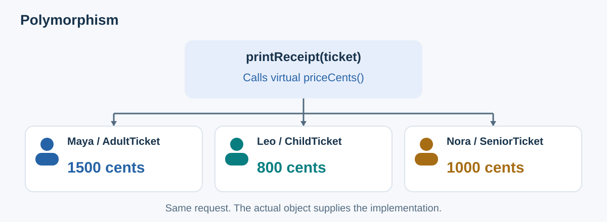
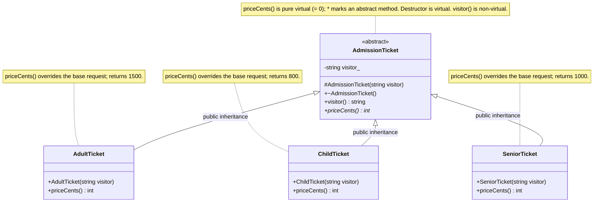
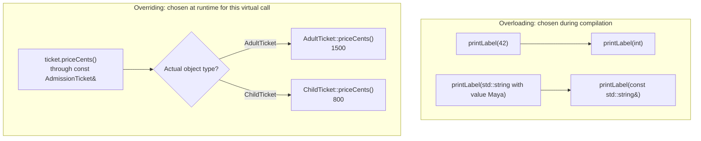

# Polymorphism: One Request, Many Behaviors

**Polymorphism lets the same function call produce the answer supplied by the object's own class.** A receipt asks `priceCents()` on an admission ticket. An adult ticket returns 1500; a child ticket returns 800.

The receipt uses the same request for both tickets. It does not need an `if` statement to choose the adult or child price.

C++ can choose a function before a program runs, during compilation, or while the program is running. This chapter starts with the second kind, called **runtime polymorphism**. A **virtual function** lets a call through a base reference use the version provided by the actual object.

We use the same tickets from [Inheritance](04_Inheritance.md): Maya's `AdultTicket` costs 1500 cents, Leo's `ChildTicket` costs 800 cents, and Nora's later `SeniorTicket` costs 1000 cents.

The inheritance chapter shared the visitor name and entrance rule. Adult and child classes supplied their own price functions, so a base reference could not ask for a price yet.

Here, the base declares a virtual price function, and each ticket class supplies its answer. We can then use the receipt function from [Abstraction](03_Abstraction.md) for every category. Each complete program is independent and focuses on pricing; it leaves out entrance and tour tracking.

## Contents

1. [A real-world analogy: museum tickets](#1-a-real-world-analogy-museum-tickets)
2. [Bad vs. good: where should the price decision live?](#2-bad-vs-good-where-should-the-price-decision-live)
3. [The key intents](#3-the-key-intents)
4. [Compile-time and runtime polymorphism](#4-compile-time-and-runtime-polymorphism)
5. [Common mistakes](#5-common-mistakes)
6. [A short design checklist](#6-a-short-design-checklist)
7. [Self-test](#7-self-test)

For quick visual revision: [the virtual price contract](#class-diagram-one-price-request-three-implementations) → [runtime dispatch](#sequence-diagram-the-actual-object-supplies-the-price) → [overloading versus overriding](#decision-diagram-when-is-the-function-chosen).

## 1. A real-world analogy: museum tickets

A museum sells adult tickets and child tickets. Both are admission tickets, and both have a visitor's name and a price. Their prices differ.

At the receipt counter, the printer asks a ticket, "What is your price?" The ticket supplies its category's answer. The printer does not keep its own list of adult and child prices.

- **Inheritance:** an adult ticket and a child ticket are both kinds of admission ticket.
- **Polymorphism:** asking any ticket for its price gives the right price for that ticket.



In this example, assume the ticket category was chosen correctly at purchase. We are modeling prices, not checking ages or taking payments.

## 2. Bad vs. good: where should the price decision live?

### 2.1 A design that spreads category checks

This complete program works for two categories:

```cpp
#include <iostream>
#include <string>

struct Ticket {
    std::string visitor;
    std::string category;
};

void printReceipt(const Ticket& ticket) {
    int priceCents;

    if (ticket.category == "adult") {
        priceCents = 1500;
    } else if (ticket.category == "child") {
        priceCents = 800;
    } else {
        std::cout << "Unknown ticket category\n";
        return;
    }

    std::cout << ticket.visitor << ": " << priceCents << " cents\n";
}

int main() {
    Ticket adult{"Maya", "adult"};
    Ticket child{"Leo", "child"};

    printReceipt(adult);
    printReceipt(child);
}
```

Output:

```text
Maya: 1500 cents
Leo: 800 cents
```

The receipt function must know every category and its price. Now imagine refunds and sales reports need prices too. Each of them would copy the same `if` chain, and adding a category would mean finding and updating every copy. A typo such as `"adlut"` is also accepted when a ticket is created, and only fails later.

An `if` statement can be fine for a small, fixed set of prices. A table mapping categories to numbers can also be enough when only the data differs.

Virtual functions become useful when categories calculate their answers differently and several callers need those answers. We keep the returns as constants here so you can focus on how C++ chooses the right function.

### 2.2 A design with a common base class

`AdmissionTicket` is the **base class**, which declares the functions shared by every ticket. `AdultTicket` and `ChildTicket` are **derived classes**, which build on that base and supply their own price functions.

C++11 or newer. The base declares `priceCents()` as pure virtual (`= 0`); each concrete ticket supplies an override. The base is abstract and cannot be instantiated.

```cpp
#include <iostream>
#include <string>

class AdmissionTicket {
public:
    virtual ~AdmissionTicket() = default;

    std::string visitor() const {
        return visitor_;
    }

    virtual int priceCents() const = 0;

protected:
    explicit AdmissionTicket(const std::string& visitor)
        : visitor_(visitor) {}

private:
    std::string visitor_;
};

class AdultTicket : public AdmissionTicket {
public:
    explicit AdultTicket(const std::string& visitor)
        : AdmissionTicket(visitor) {}

    int priceCents() const override {
        return 1500;
    }
};

class ChildTicket : public AdmissionTicket {
public:
    explicit ChildTicket(const std::string& visitor)
        : AdmissionTicket(visitor) {}

    int priceCents() const override {
        return 800;
    }
};

void printReceipt(const AdmissionTicket& ticket) {
    std::cout << ticket.visitor() << ": "
              << ticket.priceCents() << " cents\n";
}

int main() {
    AdultTicket adult("Maya");
    ChildTicket child("Leo");

    printReceipt(adult);
    printReceipt(child);
}
```

Output:

```text
Maya: 1500 cents
Leo: 800 cents
```

Prices are stored as whole cents so the example avoids decimal rounding problems.

### Class diagram: one price request, three implementations

Section 2.2 design with the senior-ticket extension from section 2.4. `+` means public, `#` means protected, `-` means private; `string` represents `std::string`. All price methods are `const`.



`printReceipt(const AdmissionTicket& ticket)` uses the shared interface. It is a free function, so it is not a class box.

**Recall question:** Why can't you create a plain `AdmissionTicket` here? Its pure virtual price request has no implementation in the base.

### 2.3 Dynamic dispatch

`virtual` selects an implementation using the actual object type. `override` checks that the derived declaration matches the base request.

- **Static type:** `const AdmissionTicket&`, as declared by the receipt parameter.
- **Dynamic type:** `AdultTicket` or `ChildTicket`, depending on the object passed.

`priceCents()` uses dynamic dispatch; non-virtual `visitor()` uses the base implementation. The protected constructor controls access; the pure virtual method makes the class abstract.

### Sequence diagram: the actual object supplies the price

The receipt has the same parameter type on both calls. The actual object differs, so the virtual price call reaches a different override.

```mermaid
sequenceDiagram
    participant Main as main()
    participant Receipt as printReceipt(const AdmissionTicket&)
    participant Adult as adult: AdultTicket
    participant Child as child: ChildTicket

    Main->>Receipt: printReceipt(adult)
    Note over Receipt,Adult: Static parameter type: const AdmissionTicket&; actual object: AdultTicket
    Receipt->>Adult: visitor() uses AdmissionTicket's implementation
    Adult-->>Receipt: Maya
    Receipt->>Adult: virtual priceCents() dispatches to AdultTicket
    Adult-->>Receipt: 1500
    Note over Receipt: Prints Maya: 1500 cents

    Main->>Receipt: printReceipt(child)
    Note over Receipt,Child: Static parameter type: const AdmissionTicket&; actual object: ChildTicket
    Receipt->>Child: visitor() uses AdmissionTicket's implementation
    Child-->>Receipt: Leo
    Receipt->>Child: virtual priceCents() dispatches to ChildTicket
    Child-->>Receipt: 800
    Note over Receipt: Prints Leo: 800 cents
```

**Recall question:** Does inheriting `visitor()` make it virtual? No—only the declared virtual price request uses runtime dispatch here.

### 2.4 Add a new category

Extension to the program above:

```cpp
class SeniorTicket : public AdmissionTicket {
public:
    explicit SeniorTicket(const std::string& visitor)
        : AdmissionTicket(visitor) {}

    int priceCents() const override {
        return 1000;
    }
};
```

Usage:

```cpp
SeniorTicket senior("Nora");
printReceipt(senior);
```

The extra output is `Nora: 1000 cents`. **`printReceipt()` did not change.** Only the code that creates tickets needs to know the new category exists.

## 3. The key intents

### 3.1 Replace repeated type checks with one request

The first design makes the receipt choose a price by checking the category. The second design lets the ticket answer, so the receipt can just call `priceCents()`.

**Replace Conditional with Polymorphism** is the name for moving repeated category checks into functions supplied by each class [1]. For tickets, the receipt's adult-or-child `if` becomes the `priceCents()` functions in the adult and child classes.

### 3.2 Add new kinds without editing working code

The **open–closed principle** encourages adding a new case without rewriting the code that already handles existing cases [2]. Here, we add a senior class instead of editing the receipt's price logic.

Adding `SeniorTicket` leaves `printReceipt()` unchanged. Other functions using the same base name and price requests can accept a senior ticket too, as long as it keeps those functions' promises.

### 3.3 Keep each kind's behavior with that kind

The adult price is returned in `AdultTicket::priceCents()`. Receipt, refund, and report code can all call that function, so changing the adult rule requires one pricing edit.

### 3.4 Let callers depend on the general type

`printReceipt()` only knows `AdmissionTicket`. That also makes testing easier: you can pass a pretend ticket with a known price and check the receipt.

That test ticket would derive from `AdmissionTicket` and override `priceCents()` to return a chosen value. This lets a test check receipt formatting independently of real pricing rules.

This base both stores the visitor name and declares a virtual price request. Another design could use a base that only declares requests and stores no ticket fields. Such a class is often called an **interface class**. Use that design when you need to share the requests without sharing stored data.

### 3.5 Every version must keep the same promise

Polymorphism only works if each version of `priceCents()` means the same thing. Suppose the base promises "a price in cents, zero or more, without changing the ticket". A derived ticket that returned dollars would compile but give wrong receipts. This rule is the **Liskov Substitution Principle**, covered in [Inheritance](04_Inheritance.md).

### 3.6 How the four ideas fit together

| Concept | Purpose | In this example |
|---------|---------|-----------------|
| [Encapsulation](02_Encapsulation.md) | Control how callers access stored data | The visitor name stays private; the earlier editable-price version also checked price changes |
| [Abstraction](03_Abstraction.md) | Let callers request a result without learning how it is produced | Receipt code needs a name and a price, not how the price is worked out |
| [Inheritance](04_Inheritance.md) | Define a specific type from a general type | `AdultTicket` derives from `AdmissionTicket` |
| Polymorphism | Let the same base request get each ticket class's own answer | `priceCents()` runs the actual ticket's version |

## 4. Compile-time and runtime polymorphism

**Compile-time polymorphism** means choosing the function while the code is being compiled, before the program runs. Function overloading, operator overloading, and templates let C++ make this choice.

**Runtime polymorphism** means choosing a virtual function's version while the program runs. Our receipt does this when it calls `priceCents()` through an admission reference.

| Form | What it does | Needs inheritance? |
|------|--------------|--------------------|
| Function overloading | Several functions share a name but take different parameters | No |
| Operator overloading | Define what `+`, `==` and so on mean for your own types | No |
| Templates | Write code once and let the compiler produce a version for each type | No |
| Virtual functions | Pick the actual object's version of a function while running | Yes |

### 4.1 Overloading is different from overriding

**Overloading** uses the same name with different parameter lists; changing only the return type is insufficient. **Overriding** supplies a derived implementation of a virtual base method, with a matching signature and qualifiers [3].

Separate overloading example:

```cpp
#include <iostream>
#include <string>

void printLabel(int ticketNumber) {
    std::cout << "Ticket number: " << ticketNumber << '\n';
}

void printLabel(const std::string& visitor) {
    std::cout << "Visitor: " << visitor << '\n';
}

int main() {
    printLabel(42);
    printLabel(std::string("Maya"));
}
```

Output:

```text
Ticket number: 42
Visitor: Maya
```

### Decision diagram: when is the function chosen?

These branches summarize the two examples above. For overloading, the compiler uses argument types and the overload rules. For the virtual price call, runtime dispatch uses the actual object's type.



**Recall question:** What separates the two? Overloading selects among different parameter lists; overriding supplies a derived implementation of the same virtual request.

## 5. Common mistakes

### 5.1 Forgetting `virtual` in the base class

If the base function is not virtual, a same-named function in a derived class does **not** replace it for calls through the base. `printReceipt()` would always call the base version. Inheritance alone does not make a function virtual.

### 5.2 Leaving out `override`

Suppose you accidentally write `int priceCents() override` in `ChildTicket`, forgetting `const`. Because of `override`, the compiler reports an error: there is no matching base function to replace.

Without `override`, the missing-`const` function becomes a separate function. It does not supply the base's required price function, so this `ChildTicket` stays abstract and cannot be created.

If the base had its own price answer instead of `= 0`, a call through the base would keep using that answer. Writing `override` catches the mismatch at the derived declaration [4].

### 5.3 Passing polymorphic objects by value

`printReceipt(const AdmissionTicket& ticket)` works with the real ticket. If a function instead took a base-class object by value, C++ would copy only the base part and lose the derived part.

**Object slicing** means a base-class copy leaves out the derived class's fields and type. In a hierarchy with a concrete base, the copy would become a plain base object, so its virtual calls would use the base's answers.

In our example, `void printReceipt(AdmissionTicket ticket)` does not even compile, because you cannot create an abstract `AdmissionTicket`. Pass polymorphic objects by reference or pointer [5].

### 5.4 Missing a virtual destructor

Deleting an `AdultTicket` through an `AdmissionTicket*` requires a virtual base destructor; otherwise behavior is undefined.

The same applies to `std::unique_ptr<AdmissionTicket>`, a smart pointer that deletes the ticket for you. Our example uses local objects, but the virtual destructor keeps the class safe for those other uses [6].

### 5.5 Calling virtual functions from the base constructor

During the base constructor, the adult portion is not ready yet. During the base destructor, the adult portion has already been cleaned up. A virtual call made from either base function therefore uses the base's version.

Our base has no price answer because `priceCents()` is pure virtual. Calling that pure virtual function from the base constructor or destructor has undefined behavior [3]. Keep price requests outside those functions.

### 5.6 Bringing the type checks back

If receipt or refund code checks the ticket category just to calculate a price, let it call the virtual price function instead. If another shared request needs different answers per ticket, consider declaring that request in the base too.

Code that creates tickets still chooses which class to construct. For example, the purchase step creates an `AdultTicket` when the buyer selects adult admission.

### 5.7 Using polymorphism where a value would do

If adult, child and senior tickets differ only by a number, a single `Ticket` class with a `priceCents_` member, or a lookup table, is simpler. Use virtual functions when the kinds actually *behave* differently.

## 6. A short design checklist

1. Name the request that every kind must answer, such as "give your price".
2. Write down what that request promises, so every version keeps the same meaning.
3. Check that the kinds really behave differently; otherwise store a value instead.
4. Make the request `virtual` in the base class, and use `override` in each derived class.
5. Give the base class a virtual destructor if objects may be deleted through a base pointer.
6. Use a base reference or pointer when a function must keep the actual ticket type.
7. Let receipt code ask for the price instead of checking whether the ticket is adult or child.
8. Try adding a new kind: only the new class and the creation code should change.

## 7. Self-test

**What is the difference between inheritance and polymorphism?**

<details>
<summary>Answer</summary>

Inheritance defines a specific type from a general one. Polymorphism lets one request produce type-specific behavior. Here, inheritance connects the ticket types, and virtual calls pick each ticket's own price.

</details>

**Why does `printReceipt(child)` print 800, even though its parameter is an `AdmissionTicket&`?**

<details>
<summary>Answer</summary>

The reference refers to the real `ChildTicket`, and `priceCents()` is virtual. C++ sees that the original object is a child ticket and calls `ChildTicket::priceCents()`, which returns 800.

</details>

**What happens if `ChildTicket` declares `int priceCents() override` without `const`?**

<details>
<summary>Answer</summary>

Compilation fails because the base function ends in `const` and the derived declaration does not. `override` makes the compiler report that mismatch immediately.

</details>

**Is `visitor()` polymorphic just because it is inherited?**

<details>
<summary>Answer</summary>

No. It is an ordinary, non-virtual function. Every ticket shares the same version, chosen from the static type.

</details>

**What must change to support senior tickets?**

<details>
<summary>Answer</summary>

Add a `SeniorTicket` class that overrides `priceCents()`, and update the code that creates tickets. `printReceipt()` stays the same.

</details>

**When would a lookup table be better than virtual functions?**

<details>
<summary>Answer</summary>

When the kinds differ only by data, such as a price number, and not by behavior. A table or a single class with a price member is simpler then.

</details>

**How does overloading differ from overriding?**

<details>
<summary>Answer</summary>

Overloading means several same-named functions with different parameters; the compiler picks one from the arguments. Overriding means a derived class replaces a base virtual function; the program picks the version at runtime from the actual object.

</details>

## Sources and further reading

- [1] Martin Fowler, Refactoring catalog: [Replace Conditional with Polymorphism](https://refactoring.com/catalog/replaceConditionalWithPolymorphism.html).
- [2] Wikipedia: [Open–closed principle](https://en.wikipedia.org/wiki/Open%E2%80%93closed_principle).
- [3] cppreference: [Virtual functions](https://en.cppreference.com/w/cpp/language/virtual.html), including overriding and virtual calls during construction and destruction.
- [4] C++ Core Guidelines: [C.128 — Virtual functions should specify exactly one of `virtual`, `override`, or `final`](https://isocpp.github.io/CppCoreGuidelines/CppCoreGuidelines#rh-override).
- [5] C++ Core Guidelines: [C.145 — Access polymorphic objects through pointers and references](https://isocpp.github.io/CppCoreGuidelines/CppCoreGuidelines#rh-poly).
- [6] C++ Core Guidelines: [C.127 — A class with a virtual function should have a virtual or protected destructor](https://isocpp.github.io/CppCoreGuidelines/CppCoreGuidelines#rh-dtor).
- Wikipedia: [Polymorphism (computer science)](https://en.wikipedia.org/wiki/Polymorphism_(computer_science)).
