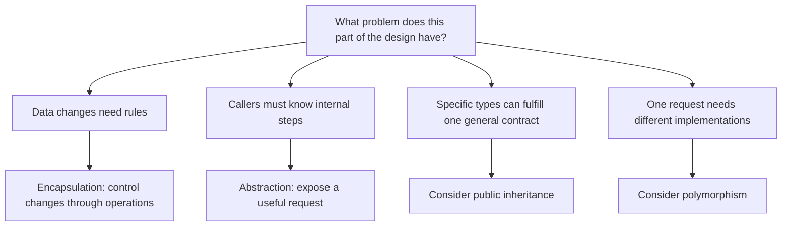
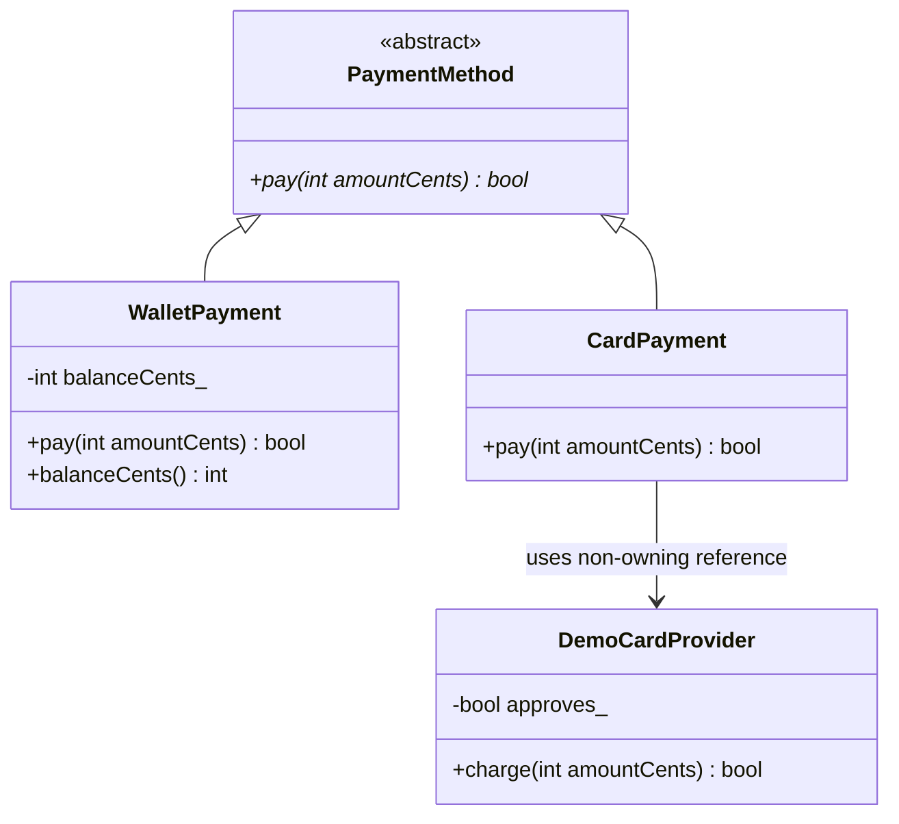

# When to Choose Encapsulation, Abstraction, Inheritance, and Polymorphism

**Choose an OOP concept because it solves a specific design problem.** You do not need to use all four concepts in every class.

This guide uses a **food delivery app**, as requested. An `Order` controls its delivery status. Checkout can accept either `WalletPayment` or `CardPayment`. Wallet payment deducts a stored balance; card payment asks a payment provider to charge a card.

These concepts answer different questions, so a single design can use several at once:

| Concept | Main question | Problem it solves |
|---------|---------------|-------------------|
| Encapsulation | Who may change this data, and under what rules? | Callers can put an object into an invalid state |
| Abstraction | What useful operation should callers see? | Callers must understand too many implementation details |
| Inheritance | Can this specific type fulfill the general type's promises? | Related types need a common contract or suitable shared behavior |
| Polymorphism | Should the same request use different implementations? | Callers repeatedly choose behavior based on the object's type |

## Contents

1. [Start with responsibilities and requirements](#1-start-with-responsibilities-and-requirements)
2. [Choose encapsulation to protect state](#2-choose-encapsulation-to-protect-state)
3. [Choose abstraction to simplify what callers need to know](#3-choose-abstraction-to-simplify-what-callers-need-to-know)
4. [Choose inheritance for a substitutable relationship](#4-choose-inheritance-for-a-substitutable-relationship)
5. [Choose polymorphism for different implementations of one request](#5-choose-polymorphism-for-different-implementations-of-one-request)
6. [Complete payment example](#6-complete-payment-example)
7. [How the concepts work together](#7-how-the-concepts-work-together)
8. [Cases where a simpler design is enough](#8-cases-where-a-simpler-design-is-enough)
9. [Common mistakes](#9-common-mistakes)
10. [A practical decision checklist](#10-a-practical-decision-checklist)
11. [Self-test](#11-self-test)

For quick revision: [choosing a concept](#decision-diagram-match-the-concept-to-the-problem) → [payment relationships](#class-diagram-contract-and-implementations) → [design checklist](#10-a-practical-decision-checklist).

## 1. Start with responsibilities and requirements

Before selecting a concept, describe what the application must do and what must always remain true.

For this example:

- An order starts as `Placed`, can become `Delivered` or `Cancelled`, and cannot leave either final state.
- An order's total must be positive and stays fixed in this simplified model.
- A wallet balance must never become negative.
- Checkout should attempt a payment without knowing how each payment method works.
- For the payment example, `pay(amountCents)` receives a positive amount. It returns `true` if the payment succeeds and `false` if it fails. A failed attempt must not deduct money.

Assign ownership of those rules:

| Responsibility | Owner | Reason |
|----------------|-------|--------|
| Order status transitions | `Order` | It owns the status and can validate every change |
| Wallet balance and deductions | `WalletPayment` | It owns the funds used for wallet payment |
| Card provider interaction | `CardPayment` | It knows how to request a card charge |
| Common payment promise | `PaymentMethod` | It describes what every payment implementation must support |
| Starting a payment attempt | `checkout()` | It needs the result, without choosing the payment algorithm |

These are teaching models. The payment example below uses a simulated card provider. It does not implement a production payment system, delivery workflow, or persistent order storage.

### Decision diagram: match the concept to the problem

Read these as independent questions. More than one answer can apply.



**Recall question:** If you only need to prevent an invalid status change, do you need inheritance? No. An ordinary class with controlled operations is enough.

## 2. Choose encapsulation to protect state

**Encapsulation keeps data and its operations together and controls access to that data.** Use it when a change must obey a rule or when several fields must stay consistent.

An **invariant** is a condition that must remain true for a valid object. Here, a wallet's nonnegative balance is an invariant; permitted order status transitions are another rule the object must enforce.

### 2.1 The warning sign: callers can bypass the rules

Without controlled access, code can directly change an order:

```cpp
// Partial snippet: a design that permits invalid transitions.
enum class Status { Placed, Delivered, Cancelled };

struct Order {
    int totalCents;
    Status status;
};

// Inside a function:
Order order{2500, Status::Delivered};
order.status = Status::Cancelled;
order.totalCents = -100;
```

Every caller must remember the same rules. A new caller can forget them, and an existing caller can accidentally bypass them.

### 2.2 Give the object control over its transitions

Complete program, C++11 or newer:

```cpp
#include <iostream>
#include <stdexcept>

enum class Status { Placed, Delivered, Cancelled };

class Order {
public:
    explicit Order(int totalCents) : totalCents_(totalCents) {
        if (totalCents <= 0) {
            throw std::invalid_argument("Order total must be positive");
        }
    }

    int totalCents() const { return totalCents_; }
    Status status() const { return status_; }

    bool cancel() {
        if (status_ != Status::Placed) {
            return false;
        }
        status_ = Status::Cancelled;
        return true;
    }

    bool markDelivered() {
        if (status_ != Status::Placed) {
            return false;
        }
        status_ = Status::Delivered;
        return true;
    }

private:
    int totalCents_;
    Status status_ = Status::Placed;
};

int main() {
    std::cout << std::boolalpha;

    Order delivered(2500);
    std::cout << "Deliver: " << delivered.markDelivered() << '\n';
    std::cout << "Cancel delivered order: " << delivered.cancel() << '\n';

    Order cancelled(2500);
    std::cout << "Cancel placed order: " << cancelled.cancel() << '\n';
    std::cout << "Deliver cancelled order: " << cancelled.markDelivered() << '\n';
}
```

Output:

```text
Deliver: true
Cancel delivered order: false
Cancel placed order: true
Deliver cancelled order: false
```

`Order` owns the checks. Other code requests an action, and the object either accepts it or preserves its current state.

### 2.3 Private fields alone are insufficient

An unrestricted `setStatus(Status value)` would let callers make the same invalid transition through a function. The field would be private, but the rule would still be unprotected.

Expose operations that match valid changes: `cancel()` and `markDelivered()`. A setter is reasonable when arbitrary changes are valid or when it validates the complete rule.

**Choose encapsulation when you think:** “This data must not be changed freely.”

Read more: [Encapsulation](02_Encapsulation.md).

## 3. Choose abstraction to simplify what callers need to know

**Abstraction gives callers a useful operation without requiring them to understand its implementation.** Start from what the caller needs to accomplish.

Checkout needs to attempt a payment. It should not have to perform these details itself:

- Read and update wallet storage.
- Check whether wallet funds are sufficient.
- Contact a card provider and interpret its response.

### 3.1 Expose the operation the caller actually needs

Compare these interfaces:

```cpp
// Partial snippets: two possible interfaces for wallet payment.

// The caller must coordinate payment details.
int readBalanceCents() const;
void writeBalanceCents(int balanceCents);

// The wallet owns the complete payment operation.
bool pay(int amountCents);
```

The second interface lets checkout ask for the intended result. It also gives the wallet one place to enforce balance rules.

For this guide, `pay()` has a clear promise: a positive amount is expressed in cents, success means the payment completed, and failure leaves funds unchanged. A real provider may need a richer result for pending or uncertain outcomes; then the interface should express those outcomes rather than pretend they are simple failures.

### 3.2 Abstraction is not the same as an abstract class

If your application accepts only wallet payments, an ordinary `WalletPayment` with `pay()` already provides abstraction. There is no need to create a virtual base class just to hide the wallet's details.

A function such as `calculateDeliveryFee()` also provides abstraction: callers need its answer, without knowing its calculation steps.

### 3.3 Abstraction and encapsulation often overlap

`Order::cancel()` does both:

- It provides **abstraction** by exposing a meaningful request.
- It provides **encapsulation** by checking the status before changing it.

The distinction is the design question. Abstraction focuses on what callers need to understand. Encapsulation focuses on how the object controls its state.

**Choose abstraction when you think:** “The caller should ask for a result instead of managing the details.”

Read more: [Abstraction](03_Abstraction.md).

## 4. Choose inheritance for a substitutable relationship

**Public inheritance lets a specific class be used through a general class's interface.** The derived class must keep the base class's promises.

The common payment contract can be written as:

```cpp
// Partial snippet.
class PaymentMethod {
public:
    virtual ~PaymentMethod() = default;
    virtual bool pay(int amountCents) = 0;
};
```

`WalletPayment` and `CardPayment` can derive from it because both can attempt a payment under the same contract.

### 4.1 Use the substitution test

Ask: **“If a function accepts `PaymentMethod&`, can it sensibly use either implementation without adding special exceptions?”**

Both must interpret the amount as cents and agree on what success and failure mean. If wallet payment deducted funds but returned `false`, it would violate the contract even though the C++ code compiled.

This is the practical meaning of the **Liskov Substitution Principle**: code written for the general type should remain correct when given a valid derived type.

The phrase “is a” helps you identify candidates, but keeping the contract is the stronger test.

### 4.2 Shared fields do not establish the relationship

An `Order` and a `WalletPayment` might both store an integer related to money. That does not make an order a wallet or a payment method.

Similarly, needing to reuse a logging function does not make `Order` a kind of `Logger`. Put reusable work in a helper function or give the object a collaborator.

### 4.3 Consider composition for “has a” relationships

**Composition builds an object using other objects as parts or collaborators.** For example, `CardPayment` uses a card provider. It is not a kind of card provider.

The complete example below gives `CardPayment` a reference to a provider. That is a non-owning collaboration: the provider must outlive the payment object. Storing a collaborator by value or with an owning smart pointer is another choice when the payment object should own it.

Public inheritance expresses a type relationship; object members and references express how objects work together.

**Choose public inheritance when you think:** “This specific type can keep the general type's promises.”

Read more: [Inheritance](04_Inheritance.md).

## 5. Choose polymorphism for different implementations of one request

**Polymorphism lets one interface work with multiple implementations.** For C++ runtime polymorphism, a virtual call through a base reference or pointer selects the actual object's implementation.

### 5.1 The warning sign: callers repeatedly choose by type

```cpp
// Partial snippet: assume these payment operations exist.
if (paymentType == "wallet") {
    payFromWallet(amountCents);
} else if (paymentType == "card") {
    chargeCard(amountCents);
}
```

A small conditional in one place can be fine. The design becomes harder to maintain when checkout, subscriptions, and other payment callers all repeat the selection logic.

Each caller then needs to know every payment type, and adding a type requires changing those callers.

### 5.2 Let the caller depend on the shared request

```cpp
// Partial snippet: PaymentMethod is declared in section 4.
bool checkout(PaymentMethod& payment, int amountCents) {
    return payment.pay(amountCents);
}
```

Wallet payment checks and deducts a local balance. Card payment delegates to a provider. These are different operations behind the same request.

Checkout can accept a later implementation without changing its payment logic, provided the implementation keeps the contract. The code that constructs or selects the payment object still needs to know which implementation the user chose.

### 5.3 Runtime polymorphism is one option

Use a virtual interface when callers need to handle interchangeable implementations during execution. It is useful when the payment method is selected from user input or configuration.

If the implementation is known during compilation, templates or an ordinary concrete parameter may be enough. C++ also supports compile-time polymorphism through mechanisms such as templates and overloading.

**Choose runtime polymorphism when you think:** “This caller should make the same request regardless of which implementation it receives.”

Read more: [Polymorphism](05_Polymorphism.md).

## 6. Complete payment example

This independent program combines the payment contract with two implementations. C++11 or newer. Amounts use whole cents; zero and negative payment amounts are rejected.

`DemoCardProvider` simulates approval or rejection. It makes no network requests and processes no real money. Its boolean result represents a definite outcome in this example.

```cpp
#include <iostream>
#include <stdexcept>

class PaymentMethod {
public:
    virtual ~PaymentMethod() = default;
    virtual bool pay(int amountCents) = 0;
};

class WalletPayment : public PaymentMethod {
public:
    explicit WalletPayment(int balanceCents) : balanceCents_(balanceCents) {
        if (balanceCents < 0) {
            throw std::invalid_argument("Wallet balance must not be negative");
        }
    }

    bool pay(int amountCents) override {
        if (amountCents <= 0 || amountCents > balanceCents_) {
            return false;
        }
        balanceCents_ -= amountCents;
        return true;
    }

    int balanceCents() const { return balanceCents_; }

private:
    int balanceCents_;
};

class DemoCardProvider {
public:
    explicit DemoCardProvider(bool approves) : approves_(approves) {}

    bool charge(int amountCents) {
        return amountCents > 0 && approves_;
    }

private:
    bool approves_;
};

class CardPayment : public PaymentMethod {
public:
    explicit CardPayment(DemoCardProvider& provider) : provider_(provider) {}

    bool pay(int amountCents) override {
        if (amountCents <= 0) {
            return false;
        }
        return provider_.charge(amountCents);
    }

private:
    // The provider must outlive this payment object.
    DemoCardProvider& provider_;
};

bool checkout(PaymentMethod& payment, int amountCents) {
    return payment.pay(amountCents);
}

int main() {
    std::cout << std::boolalpha;

    WalletPayment wallet(3000);
    std::cout << "Wallet payment: " << checkout(wallet, 2500) << '\n';
    std::cout << "Wallet balance: " << wallet.balanceCents() << '\n';
    std::cout << "Insufficient wallet funds: " << checkout(wallet, 2500) << '\n';
    std::cout << "Balance after failure: " << wallet.balanceCents() << '\n';

    DemoCardProvider approvingProvider(true);
    CardPayment approvedCard(approvingProvider);
    std::cout << "Approved card: " << checkout(approvedCard, 2500) << '\n';

    DemoCardProvider decliningProvider(false);
    CardPayment declinedCard(decliningProvider);
    std::cout << "Declined card: " << checkout(declinedCard, 2500) << '\n';

    std::cout << "Invalid amount: " << checkout(approvedCard, 0) << '\n';
}
```

Output:

```text
Wallet payment: true
Wallet balance: 500
Insufficient wallet funds: false
Balance after failure: 500
Approved card: true
Declined card: false
Invalid amount: false
```

### Class diagram: contract and implementations



The diagram omits constructors and the virtual destructor for brevity. `*` marks the abstract method. `balanceCents()` is `const` in the code.

**Recall question:** Why is there an inheritance arrow from `WalletPayment` but a usage arrow from `CardPayment` to the provider? A wallet payment fulfills the payment contract; a card payment uses a provider as a collaborator.

## 7. How the concepts work together

| Code choice | Concept | Why it helps |
|-------------|---------|--------------|
| Private `Order::status_` with checked operations | Encapsulation | Callers cannot bypass transition rules |
| Private `WalletPayment::balanceCents_` with checked deductions | Encapsulation | Payment cannot make the balance negative |
| `pay(amountCents)` | Abstraction | Callers ask for payment without coordinating its steps |
| `WalletPayment : public PaymentMethod` | Inheritance | Wallet payment supports the general payment contract |
| Virtual call in `checkout()` | Runtime polymorphism | One caller invokes the implementation of the supplied object |
| `CardPayment` holds a provider reference | Object collaboration | Provider interaction is delegated to another object |

You can apply encapsulation and abstraction without any hierarchy, as `Order` does. You can also declare an inheritance relationship without getting runtime dispatch: the function must be virtual, and the call must preserve access to the derived object.

Inheritance and polymorphism work together here, but they describe different decisions. Inheritance establishes the shared type relationship. Polymorphism makes calls use the appropriate implementation.

## 8. Cases where a simpler design is enough

### 8.1 One implementation: use a concrete class

If only wallet payments are supported, start with `WalletPayment` and call its `pay()` directly. Introduce a common payment interface when interchangeability becomes a real need.

A concrete class still supports encapsulation and abstraction.

### 8.2 Differences are just values: store data

Suppose two delivery zones use the same fee algorithm, differing only in the base fee. A `DeliveryZone` value with a `baseFeeCents` field may be sufficient.

Creating subclasses just to return different constants can add more structure than the problem needs. Consider distinct implementations when their calculations, dependencies, or workflows actually differ.

### 8.3 A small fixed choice: a conditional can be clear

A single `if` or `switch` over a small, stable set of choices can be appropriate. Repeated conditionals, independently changing implementations, and a need for interchangeable dependencies are stronger reasons to introduce polymorphism.

Some selection must remain: the purchase screen or a factory chooses which payment object to create. Polymorphism keeps that selection out of callers that only need to attempt payment.

### 8.4 Simple data with no protected rules: public fields can be fine

A coordinate, a report row, or a simple delivery estimate may be a plain `struct`. Private fields with trivial getters and setters are not automatically a better design.

Use controlled access when the object owns rules, manages resources, or needs freedom to change its representation.

## 9. Common mistakes

### 9.1 Trying to assign exactly one concept to each class

A class can provide both abstraction and encapsulation. A hierarchy can support inheritance and polymorphism. Evaluate the purpose of each design choice instead of trying to label an entire class with one concept.

### 9.2 Starting with a hierarchy before identifying the contract

“Card and wallet both involve money” is too vague. First define the common operation and its promises. Then decide whether both types can support them.

### 9.3 Adding an operation that some derived types cannot honor

Suppose you add `refund()` to `PaymentMethod`, but a payment method cannot provide the promised refund behavior. A derived method that always throws “unsupported” is evidence that the interface may be too broad.

Consider a separate refund capability for callers that need it. A normal declined payment differs from an implementation that cannot support the required operation at all.

### 9.4 Moving all internal steps into the public interface

If checkout must call `checkFunds()`, `deductFunds()`, and `saveBalance()` in the correct order, the interface leaves the payment rule with the caller. A single `pay()` operation gives the payment object control over those coordinated steps.

### 9.5 Using inheritance solely to avoid duplicate code

Sharing code is useful, but a base class also creates a relationship and constraints. Use a helper or collaborator when unrelated classes only need a common calculation or service.

### 9.6 Losing runtime behavior in C++

Use base references or pointers for runtime polymorphism. Copying a derived object into a concrete base object causes **object slicing**: the copy contains only the base part. In this example, `PaymentMethod` is abstract, so passing it by value is invalid.

Write `override` on derived implementations so the compiler checks the signature. Provide a virtual base destructor when objects may be deleted through a base pointer; this example includes one.

## 10. A practical decision checklist

Use this sequence when designing a feature:

1. **Describe the requirement.** What must the feature do, and what must remain true?
2. **Assign responsibility.** Which object owns the state or performs the operation?
3. **Design a useful public request.** Prefer `cancel()` or `pay()` when callers need those actions. This is abstraction.
4. **Protect the rules behind that request.** Control state changes and reject invalid operations. This is encapsulation.
5. **Check for multiple implementations.** Do they differ in behavior, or only in data?
6. **Define the common promise.** Can each implementation meet it? If so, public inheritance may express that relationship.
7. **Check what callers need.** If one caller must accept interchangeable implementations during execution, virtual dispatch may help.
8. **Choose how objects collaborate and who owns them.** Use members, references, or owning pointers according to the required lifetimes.
9. **Try the simpler alternative.** A value, ordinary function, concrete class, or small conditional may already satisfy the requirement.

You do not have to follow a strict chronology. Defining the public operation often reveals missing state rules, and a new implementation can reveal a weakness in the common contract.

## 11. Self-test

**A wallet balance must never become negative. Which concept addresses this directly?**

<details>
<summary>Answer</summary>

Encapsulation. Keep the balance under the wallet's control and validate deductions before changing it. Making the field private without controlling the operations is insufficient.

</details>

**Checkout should not know how card authorization works. Which concept is involved?**

<details>
<summary>Answer</summary>

Abstraction. Expose a meaningful payment request. This can work with an ordinary concrete class; an abstract base class is optional.

</details>

**Checkout must accept a wallet or card chosen by the user. Which concepts can work together?**

<details>
<summary>Answer</summary>

Public inheritance can establish the common payment contract. Runtime polymorphism can select the actual implementation of the virtual `pay()` request through a base reference or pointer.

</details>

**An order uses a logger. Should `Order` inherit from `Logger`?**

<details>
<summary>Answer</summary>

Usually no. An order is not a logger. Give it access to a logger collaborator if logging belongs in that design.

</details>

**Two delivery zones use the same calculation but different base fees. Do they need subclasses?**

<details>
<summary>Answer</summary>

Usually a value or configuration field is enough. Different data alone does not require different implementations.

</details>

**A wallet deducts money but returns `false`. Has it fulfilled the payment contract in this guide?**

<details>
<summary>Answer</summary>

No. The contract says a failed attempt must not deduct funds. Substitution requires consistent meaning and behavior, not just matching C++ signatures.

</details>

**Does `Order::cancel()` demonstrate abstraction or encapsulation?**

<details>
<summary>Answer</summary>

Both. It exposes a useful request and controls the internal state change needed to carry it out.

</details>

## Further reading

Online browsing was unavailable while creating this guide. These authoritative references are provided for further reading; their current contents were not checked during this session.

- [C++ Core Guidelines: C.2 — Use class if the class has an invariant; use struct if the data members can vary independently](https://isocpp.github.io/CppCoreGuidelines/CppCoreGuidelines#Rc-struct).
- [C++ Core Guidelines: C.120 — Use class hierarchies to represent concepts with inherent hierarchical structure](https://isocpp.github.io/CppCoreGuidelines/CppCoreGuidelines#Rh-domain).
- [C++ Core Guidelines: C.121 — If a base class is used as an interface, make it a pure abstract class](https://isocpp.github.io/CppCoreGuidelines/CppCoreGuidelines#Rh-abstract).
- [Martin Fowler: Replace Conditional with Polymorphism](https://refactoring.com/catalog/replaceConditionalWithPolymorphism.html).
- [cppreference: Virtual functions](https://en.cppreference.com/w/cpp/language/virtual.html).
